<p align="center">
  🇺🇸 <strong>English</strong> &nbsp;|&nbsp; 🇧🇷 <a href="README.pt-BR.md">Português</a>
</p>

<h1 align="center">🎸 NotesId</h1>

<p align="center">
  <strong>Identifies which guitar string and fret a note was played on — using 100% classical digital signal processing and acoustics physics (zero machine learning).</strong>
</p>

<p align="center">
  <a href="https://github.com/lucasrech/NotesId/actions/workflows/ci.yml">
    
  </a>
  
  
  
  
  
  
  
  
  <a href="LICENSE">
    
  </a>
</p>

> [!NOTE]
> **Package name & glossary:** The public project name is **NotesId**, while the internal Python package is `guitar_string_identifier` (kept for stable imports). Unfamiliar with terms like *f0*, *partials*, *inharmonicity*, *FFT*, or *cents*? Read the plain-language [**Glossary**](docs/GLOSSARY.md).

## Table of Contents

1. [What Is NotesId](#1-what-is-notesid)
2. [How It Works](#2-how-it-works)
3. [Features](#3-features)
4. [Results and Limitations](#4-results-and-limitations)
5. [Tutorial](#5-tutorial)
6. [Calibration](#6-calibration)
7. [FAQ and Troubleshooting](#7-faq-and-troubleshooting)
8. [Repository Structure, Tests, and Contributing](#8-repository-structure-tests-and-contributing)
9. [Dataset, Credits, Citation, and License](#9-dataset-credits-citation-and-license)

---

## 1. What Is NotesId

On a piano, middle C (`C4`, ~261.63 Hz) exists on only **one** key. On a standard 6-string guitar, **the exact same C4 can be played in 5 different positions**:

| String | Fret | Physical feel | Measured inharmonicity $B$ (Stratocaster) |
|---:|---:|---|---:|
| 2 (B3) | 1 | Thin, long plain steel string | `3.4 × 10⁻⁵` |
| 3 (G3) | 5 | Thicker plain steel string | `2.0 × 10⁻⁴` |
| 4 (D3) | 10 | Wound string, medium length | `1.9 × 10⁻⁴` |
| 5 (A2) | 15 | Thick wound string, short | `4.4 × 10⁻⁴` |
| 6 (E2) | 20 | Thickest wound string, very short | `1.5 × 10⁻³` |

A regular tuner only tells you *"you played C4"*. **NotesId** tells you **which string and which fret** produced that note — using only acoustics physics and classical signal processing, with **no machine learning**.

---

## 2. How It Works

Imagine bending a soft shoelace versus a thin metal rod: the metal rod resists tight bends and snaps back faster. Real steel guitar strings have **bending stiffness**, which pushes their upper overtones ([**partials**](docs/GLOSSARY.md#harmonics--partials)) slightly sharper than exact integer multiples of the fundamental frequency ([**$f_0$**](docs/GLOSSARY.md#fundamental-frequency-f_0)):

$$f_n = n \cdot f_0 \cdot \sqrt{1 + B \cdot n^2}$$

The stiffness constant $B$ ([**inharmonicity**](docs/GLOSSARY.md#inharmonicity-b)) grows rapidly as the string is fretted higher ($B(\text{fret}) = B_0 \cdot 2^{\text{fret}/6}$), acting as a **physical fingerprint** for each `(string, fret)` position. NotesId estimates $f_0$, tracks the real partials with a high-resolution [**FFT**](docs/GLOSSARY.md#fft-fast-fourier-transform), fits $B$ robustly, combines it with per-partial [**decay**](docs/GLOSSARY.md#decay) rates ([**STFT**](docs/GLOSSARY.md#stft-short-time-fourier-transform)) and low-weight spectral cues, and ranks only the physically valid `(string, fret)` candidates with a classical [**Gaussian / Mahalanobis**](docs/GLOSSARY.md#mahalanobis-distance--gaussian-classifier) classifier.

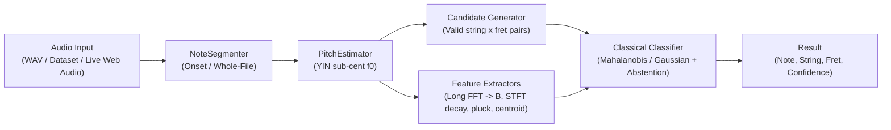

---

## 3. Features

- **100% Classical DSP (Zero ML):** YIN sub-cent pitch detection, Blackman-Harris long FFT with 4× zero-padding, parabolic peak interpolation, progressive partial tracking, Huber IRLS fit for $B$, STFT decay rates, and Gaussian/Mahalanobis classification with explicit `indeterminate` abstention.
- **Interactive Web Interface (pt-BR):** central note/string/fret/confidence display, local EGFxSet dataset browser with automatic ground-truth verification (`LabelProvider`), WAV/FLAC/OGG upload, and live spectrum plot comparing measured partials against ideal harmonics $n \cdot f_0$.
- **Live Browser Capture (`AudioWorklet`):** raw capture in Chrome/Edge with voice filters disabled, continuous progressive updates (~0.3 s → ~0.95 s), live level meter with clipping warning, and automatic rejection of chords and clipped audio.
- **Profiles & Calibration:** Pydantic-validated YAML profiles (`Capture`, `Instrument`, `Analysis`, `Calibration`), per-parameter `auto`/`manual` toggle, Guided Calibration page, and the 6-step **Auto Tuning** wizard (ranks interfaces, measures silence & 50/60 Hz hum, checks level, detects open-string tuning & alternate tunings, calibrates $B_0$, and estimates Fisher weights & thresholds).
- **Synthetic Stiff-String Generator:** Karplus-Strong waveguide with all-pass dispersion filter to verify $f_0$ and $B$ recovery on synthetic ground truth.

### Usage Modes

| Mode | Signal Path | Hardware Needed | Expected Accuracy | Status |
|---|---|---|---|---|
| **File / Dataset** | Local WAV/FLAC/OGG or EGFxSet | None (PC only) | **Reference** (87.0% Top-1 / 90.4% Decided on EGFxSet) | Recommended & tested |
| **Live — USB Audio Interface** | Guitar → 1/4" cable → Hi-Z USB interface → PC browser | USB audio interface (Hi-Z) | **Best for live use** (clean dry electrical signal) | **Recommended** |
| **Live — Mobile Phone Mic (LAN)** | Guitar → room air → phone mic → Wi-Fi (HTTPS) → PC | Phone + same Wi-Fi | **Substantially lower** (unmeasured; room echo + mic filters) |  |

> [!WARNING]
> **Using a phone microphone degrades accuracy significantly.** NotesId was designed and evaluated on a **clean, direct electrical signal** from a guitar pickup. Capturing airborne sound through a phone mic adds room echo, ambient noise, and phone voice filters that blur the tiny partial shifts used to measure inharmonicity $B$. See [Section 5.5](#55-using-a-mobile-phone-as-a-microphone-experimental) for full details and limitations.

---

## 4. Results and Limitations

All parameters ($B_0$, decay model, Fisher weights, and confidence thresholds) were calibrated **strictly on frets `0` and `12` only** (60 files) and evaluated on the **21 held-out frets** (**630 unseen files**, 585 with ≥ 2 ambiguous positions) across all 5 Stratocaster pickups. Full tables and confusion matrix: [`docs/evaluation.md`](docs/evaluation.md).

| Metric (630 unseen test notes) | Baseline (Manual) | After Auto Tuning | Delta |
|---|---:|---:|---:|
| Note identification ($f_0$) | 99.8% | **99.8%** | +0.0 pp |
| String + fret — Top-1 overall | 85.1% | **87.0%** | **+1.9 pp** |
| String + fret — Decided (≤ 10% target error) | 86.2% (97.8% cov.) | **90.4%** (92.4% cov.) | **+4.2 pp** |
| Ambiguous notes only (≥ 2 positions) — Top-1 | 83.9% | **86.0%** | **+2.1 pp** |
| Ambiguous notes only — Decided | 85.1% (97.6% cov.) | **89.6%** (91.8% cov.) | **+4.5 pp** |
| **Spotlight: 5 positions of C4** (5 pickups × 5 pos.) | 20/25 (80%) | **21/25 (84%)** | **+4.0 pp** |

> [!WARNING]
> **Known physical limitation — `(string 3, fret 5)` vs. `(string 4, fret 10)` on C4:** On standard electric strings, string 3 (G3) is thick **plain** steel while string 4 (D3) is a **wound** string with a thinner inner core. Because string 3 is stiffer than string 4, their predicted $B$ values at `(3, 5)` and `(4, 10)` differ by only ~3% against ~26% empirical spread. As a result, `(4, 10)` remains at 2/5 (and string 4 overall dropped from 63.8% to 59.0% after Auto Tuning, while strings 5 and 6 jumped +10.5 pp and +3.8 pp). NotesId uses its `indeterminate` abstention to avoid guessing blindly in this crossover zone.
>
> **Scope limits:** evaluated on one reference guitar (EGFxSet Stratocaster), **isolated single notes** only, and **clean (dry) tone**.

---

## 5. Tutorial

**Quick jump inside this chapter:**
- [5.1 Before You Start (Requirements and Compatibility)](#51-before-you-start)
- [5.2 Installation (Quick Start, Ubuntu 24.04 Native, Windows 10/11 Native)](#52-installation)
- [5.3 First Steps (Dataset and Starting the App)](#53-first-steps)
- [5.4 Live Capture and Connecting Your Guitar](#54-live-capture-and-connecting-your-guitar)
- [5.5 Using a Mobile Phone as a Microphone (Experimental)](#55-using-a-mobile-phone-as-a-microphone-experimental)
- [5.6 Using the App Screens](#56-using-the-app-screens)

### 5.1 Before You Start

> [!NOTE]
> **Author's development environment:** NotesId was developed and tested on **Ubuntu 24.04 running inside WSL2 (Windows Subsystem for Linux)**, with the web interface accessed from **Google Chrome on Windows**.

| Environment | Status | Notes |
|---|---|---|
| **Ubuntu 24.04 on WSL2** | Tested (dev environment) | Full automated test suite, dataset evaluation, and live browser capture verified. |
| **Ubuntu 24.04 (native Linux)** | Instructions provided | Same Linux commands and packages as WSL2; native desktop audio routing not tested on bare-metal Ubuntu. |
| **Windows 10/11 (native PowerShell)** | Instructions provided | Download script rewritten in pure Python for Windows compatibility; full native Windows install/run not directly executed end-to-end. |
| **Chrome / Edge (Chromium)** | Recommended & tested | Supports `AudioWorklet`, raw `getUserMedia` constraints, and WebSocket streaming cleanly. |
| **Firefox / Safari** | Untested | Web Audio API exists, but `AudioWorklet` sample-rate behavior and device labels were not tested. |

### 5.2 Installation

**Quick Start in 5 commands** (if you already have `git` and `uv` installed):

```bash
# Bash (Ubuntu / Linux) or PowerShell (Windows)
git clone https://github.com/lucasrech/NotesId.git
cd NotesId
uv sync
uv run python scripts/download_egfxset.py
uv run guitar-string-identifier
```

If you are installing from scratch, expand the guide for your operating system below:

<details>
<summary><strong>Ubuntu 24.04 (Native Linux — no WSL or Docker required)</strong></summary>

**Step 1 of 5 — Open the terminal and install Git and curl**
Open the **Terminal** app (`Ctrl + Alt + T`) and run:

```bash
# Bash (Ubuntu 24.04)
sudo apt update
sudo apt install -y git curl libsndfile1
```

> [!TIP]
> `libsndfile1` is the audio library used by `soundfile` to read WAV/FLAC/OGG files on Linux. Installing it now avoids missing-library errors later.

**Step 2 of 5 — Install `uv` (Python environment manager)**
Run the official Astral installer:

```bash
# Bash (Ubuntu 24.04)
curl -LsSf https://astral.sh/uv/install.sh | sh
```

Close and reopen the terminal (or run `source $HOME/.local/bin/env`), then confirm:

```bash
# Bash (Ubuntu 24.04)
uv --version
```

**Step 3 of 5 — Clone the repository**

```bash
# Bash (Ubuntu 24.04)
mkdir -p ~/Projects
cd ~/Projects
git clone https://github.com/lucasrech/NotesId.git
cd NotesId
```

**Step 4 of 5 — Create the Python 3.12 environment and install dependencies**
`uv` automatically downloads Python 3.12 if needed and installs all packages:

```bash
# Bash (Ubuntu 24.04)
uv sync
```

**Step 5 of 5 — Start the web interface**

```bash
# Bash (Ubuntu 24.04)
uv run guitar-string-identifier
```

Open **http://localhost:8000** in Google Chrome or Microsoft Edge.

</details>

<details>
<summary><strong>Windows 10/11 (Native — PowerShell, no WSL required)</strong></summary>

**Step 1 of 6 — Open PowerShell**
Press the **Windows** key, type **PowerShell**, and click **Windows PowerShell** (or **Terminal**).

**Step 2 of 6 — Install Git for Windows**
Run the official `winget` command in PowerShell:

```powershell
# PowerShell (Windows 10/11)
winget install --id Git.Git -e --source winget
```

**Step 3 of 6 — Install `uv` (official PowerShell installer)**

```powershell
# PowerShell (Windows 10/11)
powershell -ExecutionPolicy ByPass -c "irm https://astral.sh/uv/install.ps1 | iex"
```

*(Alternative via winget: `winget install --id=astral-sh.uv -e`.)*

**Step 4 of 6 — Open a NEW PowerShell window and pick a folder**
Close PowerShell and open a **new** PowerShell window so `git` and `uv` are recognized on your `PATH`. Confirm both work:

```powershell
# PowerShell (Windows 10/11)
git --version
uv --version
```

Choose a clean folder (for example, `Documents\Projects`):

```powershell
# PowerShell (Windows 10/11)
New-Item -ItemType Directory -Force -Path "$HOME\Documents\Projects"
Set-Location "$HOME\Documents\Projects"
```

**Step 5 of 6 — Clone and install dependencies**

```powershell
# PowerShell (Windows 10/11)
git clone https://github.com/lucasrech/NotesId.git
Set-Location NotesId
uv sync
```

*(On Windows, the `soundfile` package bundles `libsndfile` automatically — no extra system library is needed.)*

**Step 6 of 6 — Start the web interface**

```powershell
# PowerShell (Windows 10/11)
uv run guitar-string-identifier
```

Open **http://localhost:8000** in Google Chrome or Microsoft Edge.

</details>

### 5.3 First Steps

1. **(Optional) Download the clean EGFxSet dataset** (~431 MB, 690 WAV files, resumable pure-Python download with MD5 verification):
   ```bash
   # Bash or PowerShell (inside the NotesId folder)
   uv run python scripts/download_egfxset.py
   ```
2. **Start the server:**
   ```bash
   # Bash or PowerShell
   uv run guitar-string-identifier
   ```
3. **Open `http://localhost:8000`** in Chrome or Edge.
4. Click **"Destaque: 5 posições do Dó4 (C4)"** and click any file (e.g., `Corda 2 • Casa 1 · C4 · Bridge • 2-1.wav`) to see the note, string, fret, ground-truth check, candidates, and spectrum chart!

### 5.4 Live Capture and Connecting Your Guitar

#### How Live Capture Works

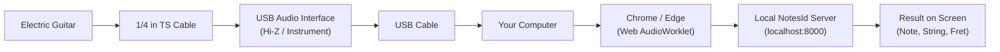

> [!IMPORTANT]
> **100% private and offline:** Your guitar audio is processed exclusively on your own computer (`localhost:8000`). **No audio is ever sent to the internet.**

#### What You Need

| Item | Requirement | Notes |
|---|---|---|
| **Guitar** | 6-string electric guitar (clean tone) | Acoustic/steel-string also works if calibrated, with lower accuracy via mic. |
| **Instrument cable** | Standard 1/4" (6.35 mm) TS guitar cable | Keep it short and shielded to minimize 60 Hz hum. |
| **Audio interface** | USB audio interface with **Instrument / Hi-Z** input | Alternatives: USB guitar cable or DI box + interface. |
| **Computer & Browser** | PC with Chrome or Edge (Chromium) | Needed for `AudioWorklet` and raw audio capture. |

> [!WARNING]
> **Why you should NOT plug a guitar directly into your PC's 3.5 mm microphone jack:** Guitar pickups have very high output impedance (~10 kΩ–500 kΩ), while PC mic jacks expect low-impedance microphones (~2 kΩ). Plugging directly loads down the pickup, dulls the upper partials needed to measure inharmonicity $B$, and introduces heavy noise and clipping.

#### Physical Connection Step by Step

<p align="center">
  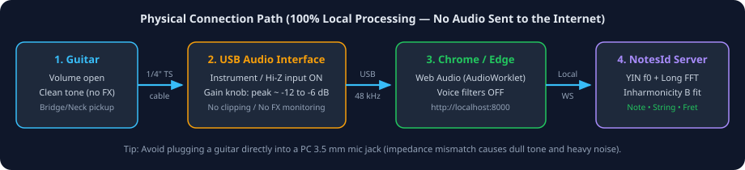
</p>
<p align="center"><em>Physical signal chain: clean guitar → 1/4" cable → Hi-Z input on USB interface → browser → local NotesId server.</em></p>

- **Step 1 of 5:** Plug the 1/4" cable into your guitar and into the **Instrument / Hi-Z** input of your USB audio interface (press the `INST` / `Hi-Z` button if present).
- **Step 2 of 5:** Open your guitar's volume knob all the way and pick one pickup position (e.g., Bridge or Neck — stick to it during calibration).
- **Step 3 of 5:** **Turn off all distortion, overdrive, chorus, delay, reverb, and amp simulators** (both pedals and software monitoring FX). NotesId needs the clean, dry string signal.
- **Step 4 of 5:** Connect the USB interface to your computer.
- **Step 5 of 5:** Adjust the physical **Gain** knob on the interface while plucking a loud note so the level peaks around **−12 dB to −6 dB** without lighting the red clip LED.

#### Operating System Settings

- **Windows 10/11:** Open **Settings → System → Sound → More sound settings (or Device properties)** → select your USB interface under **Input** → **Properties** → set **Audio enhancements** to **Off** (critical: Windows voice enhancements mistake guitar sustain for background noise and cut it off). Under **Advanced**, select **48000 Hz** (16 or 24 bit).
- **Ubuntu 24.04:** Open **Settings → Sound → Input** (or install/open `pavucontrol`) and select your USB audio interface as the input device, with input volume around 80–100% and no software noise suppression enabled.

#### Using Live Capture in the App

<p align="center">
  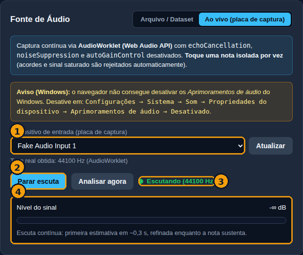
</p>
<p align="center"><em>Live capture panel captured in Chromium using test audio from EGFxSet (Bridge 2-1.wav). Numbers match the steps below.</em></p>

- **Step 1 of 4 (`①`):** On the **Identificar** tab, switch the input mode to **Ao vivo (placa de captura)**, click **Atualizar**, allow microphone permission in the browser, and choose your USB interface.
- **Step 2 of 4 (`②`):** Click **Iniciar escuta contínua**. The browser opens your interface with `echoCancellation`, `noiseSuppression`, and `autoGainControl` disabled.
- **Step 3 of 4 (`③`):** Confirm the pulsing green dot and **`Escutando (48000 Hz)`** status appear, and that **Analisar agora** becomes enabled.
- **Step 4 of 4 (`④`):** Watch the level meter while playing **one isolated note at a time**, letting it ring for **~1 second**:
  - **Ideal level:** peaks around **−18 dB to −6 dB** (green/yellow).
  - **Red `CLIPPING!` badge:** lower the physical Gain knob on your interface.
  - **"Escutando, mas sem sinal":** check cable, guitar volume, Hi-Z switch, and Windows input device.
  - The hero card shows a provisional estimate at ~0.3 s (`Refinando...`) and refines to the final string, fret, note, and confidence (or `Indeterminado` if tied).

> [!TIP]
> **Common live capture pitfalls:**
> - **Chords rejected:** NotesId is designed for isolated single notes and intentionally rejects chords with a red warning banner.
> - **60 Hz hum:** Run **⚡ Auto Tuning** (Chapter 6) so the silence step detects and excludes 60 Hz hum and its harmonics.
> - **Wrong string on your guitar:** The default `egfxset` profile was calibrated on a Stratocaster. Always calibrate for **your own guitar** (Chapter 6).

### 5.5 Using a Mobile Phone as a Microphone (Experimental)


If you do not have a USB audio interface yet and want to try NotesId quickly, you can run the server on your computer and open the web interface on a **mobile phone over your local Wi-Fi network**, using the phone's microphone as the audio input.

#### How It Works

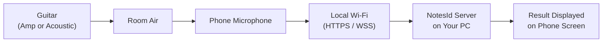

All audio stays strictly **inside your local Wi-Fi network** — nothing is uploaded to the internet.

> [!WARNING]
> **Why this mode significantly degrades accuracy:**
> - **Airborne sound, room echo, and ambient noise** mask the faint upper [partials](docs/GLOSSARY.md#harmonics--partials) ($n = 4 \dots 12$) that NotesId relies on to measure [inharmonicity $B$](docs/GLOSSARY.md#inharmonicity-b).
> - **Automatic phone and browser voice processing** (noise suppression, echo cancellation, automatic gain) is often enforced by the phone OS even when the web page requests raw audio — especially on **iPhone / Safari**.
> - **Microphone position sensitivity:** moving the phone a few centimeters changes room reflections and alters the measured spectrum.
> - **Unplugged electric guitar is too quiet:** an electric guitar played without an amp has a weak acoustic signal, low sustain, and high noise ratio.
> - **Bluetooth degrades audio heavily:** Bluetooth headset profiles (HFP/SCO) downsample audio to 8–16 kHz, destroying the upper partials.
>
> **Honest expectation:** accuracy in mobile-microphone mode **has not been measured** and is expected to be **substantially lower** than the EGFxSet clean-signal results in Chapter 4. Expect frequent `Indeterminado` responses and wrong string guesses, especially on higher frets.

#### Requirements

- **Same Wi-Fi network:** your PC and phone must be connected to the same private Wi-Fi router (guest or corporate Wi-Fi networks often enable *client isolation*, which blocks devices from reaching each other).
- **Recommended mobile browser:** **Google Chrome** (Chromium) on Android. **Safari / iOS is untested** and applies stricter audio/microphone processing.

#### Step-by-Step Setup

Expand the guide for your computer's operating system below (all examples use the sample [local IP](docs/GLOSSARY.md#local-ip--local-network-lan) `192.168.0.10` — replace it with your PC's actual IP):

<details>
<summary><strong>Windows 10/11 (PowerShell)</strong></summary>

1. **Step 1 of 9 — Find your PC's local IP:** Open PowerShell and run:
   ```powershell
   # PowerShell (Windows 10/11)
   ipconfig
   ```
   Look under **Wireless LAN adapter Wi-Fi** (or **Ethernet**) for **IPv4 Address** (for example, `192.168.0.10`).
2. **Step 2 of 9 — Start NotesId on the LAN with local HTTPS:** Mobile browsers block microphone access on non-`localhost` HTTP pages, so `--https` is required (NotesId automatically creates a [self-signed certificate](docs/GLOSSARY.md#self-signed-certificate) in `.certs/`, which is ignored by Git):
   ```powershell
   # PowerShell (inside the NotesId folder)
   uv run guitar-string-identifier --host 0.0.0.0 --port 8000 --https
   ```
3. **Step 3 of 9 — Allow port `8000` in Windows Defender Firewall (Private network only):** If Windows prompts you, check **Private networks** only (uncheck Public). Or run PowerShell **as Administrator** to add a temporary rule:
   ```powershell
   # PowerShell (Administrator) — allow port 8000 on Private Wi-Fi only
   New-NetFirewallRule -DisplayName "NotesId LAN 8000" -Direction Inbound -Protocol TCP -LocalPort 8000 -Profile Private -Action Allow
   ```
   *(To remove this rule when finished: `Remove-NetFirewallRule -DisplayName "NotesId LAN 8000"`.)*
4. **Step 4 of 9 — Open NotesId on your phone:** In Chrome on your phone, type **`https://192.168.0.10:8000`** (using your real IP and `https://`).
5. **Step 5 of 9 — Accept the self-signed certificate warning:** Chrome will display *"Your connection is not private"*. Tap **Advanced** → **Proceed to 192.168.0.10 (unsafe)**. This warning is expected **only** because your own PC generated the local certificate — **never** bypass this warning on unknown websites.
6. **Step 6 of 9 — Enable the phone microphone in NotesId:** On the **Identificar** tab, tap **Ao vivo (placa de captura)**, tap **Atualizar** (`①`), grant microphone permission, select the phone's microphone, and tap **Iniciar escuta contínua** (`②`). Confirm **`Escutando`** (`③`) turns green.
7. **Step 7 of 9 — Calibrate in the exact playing position:** Place the phone on a fixed stand near your amp or acoustic guitar and run **⚡ Auto Tuning** (Chapter 6) so NotesId measures your room's noise floor and the microphone's response in that exact spot.
8. **Step 8 of 9 — Play one isolated note at a time:** Let each note ring for ~1 second and read the result on the phone screen (expect more `Indeterminado` results and errors than with a USB interface).
9. **Step 9 of 9 — Stop the server and return to safe local mode:** Press `Ctrl + C` in PowerShell, remove the temporary firewall rule if desired, and next time start normally with `uv run guitar-string-identifier` (which listens only on `127.0.0.1`).

</details>

<details>
<summary><strong>Ubuntu 24.04 (Bash)</strong></summary>

1. **Step 1 of 9 — Find your PC's local IP:** Open Terminal and run:
   ```bash
   # Bash (Ubuntu 24.04)
   hostname -I
   ```
   Use the first IPv4 address shown (for example, `192.168.0.10`).
2. **Step 2 of 9 — Start NotesId on the LAN with local HTTPS:** Mobile browsers require [HTTPS](docs/GLOSSARY.md#https--secure-context) for microphone access on a LAN IP. NotesId auto-generates a [self-signed certificate](docs/GLOSSARY.md#self-signed-certificate) in `.certs/` (ignored by Git):
   ```bash
   # Bash (inside the NotesId folder)
   uv run guitar-string-identifier --host 0.0.0.0 --port 8000 --https
   ```
3. **Step 3 of 9 — Allow port `8000` in the firewall (`ufw`, if active):** Check `sudo ufw status`. If active, allow port `8000` **only from your local subnet** (adjust `192.168.0.0/24` to match your IP prefix):
   ```bash
   # Bash (Ubuntu 24.04) — allow only your local Wi-Fi subnet
   sudo ufw allow from 192.168.0.0/24 to any port 8000 proto tcp
   ```
   *(To revert when finished: `sudo ufw delete allow from 192.168.0.0/24 to any port 8000 proto tcp`.)*
4. **Step 4 of 9 — Open NotesId on your phone:** In Chrome on your phone, open **`https://192.168.0.10:8000`** (using your real IP and `https://`).
5. **Step 5 of 9 — Accept the self-signed certificate warning:** Tap **Advanced** → **Proceed to 192.168.0.10 (unsafe)**. Expected **only** for your own local NotesId server — **never** accept this on unknown websites.
6. **Step 6 of 9 — Enable the phone microphone in NotesId:** On **Identificar**, tap **Ao vivo (placa de captura)**, tap **Atualizar** (`①`), allow microphone permission, choose the phone's microphone, and tap **Iniciar escuta contínua** (`②`). Confirm **`Escutando`** (`③`) turns green.
7. **Step 7 of 9 — Calibrate in the exact playing position:** Rest the phone in a fixed spot and run **⚡ Auto Tuning** (Chapter 6) without moving the phone afterward.
8. **Step 8 of 9 — Play one isolated note at a time:** Let each note sustain for ~1 second and check the result on screen (expect more `Indeterminado` results and errors than with a USB interface).
9. **Step 9 of 9 — Stop the server and return to safe local mode:** Press `Ctrl + C` in Terminal, delete the `ufw` rule if you added one, and next time start normally with `uv run guitar-string-identifier` (defaults to `127.0.0.1`).

</details>

#### Mobile Interface Preview

<p align="center">
  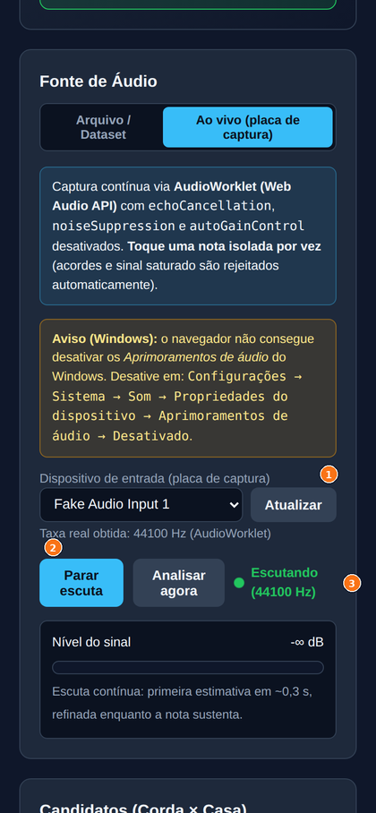
  &nbsp;&nbsp;
  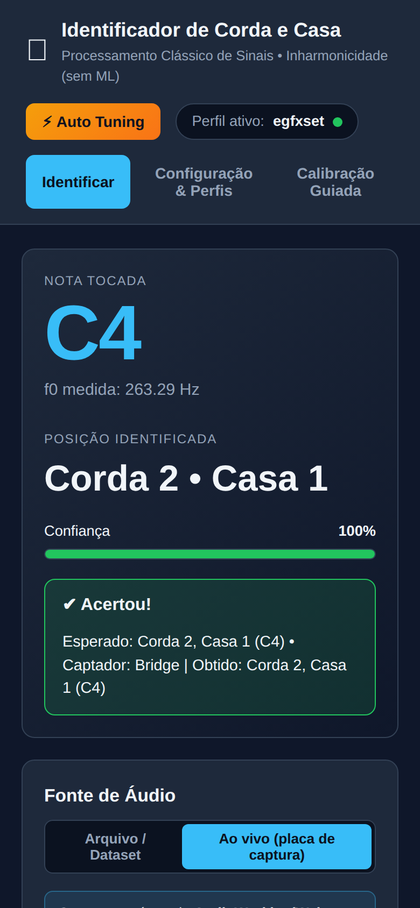
</p>
<p align="center"><em>Mobile interface captured in Chromium mobile emulation (390 px viewport, EGFxSet test audio). Left: live capture controls (① Refresh/select mic, ② Start/stop listening, ③ Active listening status). Right: identified note card on narrow screens.</em></p>

#### Tips to Minimize Quality Loss

- Play in a **quiet room** (turn off fans, TV, air conditioning, and background music).
- Place the phone **close to the amplifier speaker** (clean channel, zero reverb/delay/distortion) or **15–25 cm from an acoustic guitar's sound hole** — close enough for strong signal without clipping.
- Keep the phone on a **fixed stand or table** and do not move it between calibration and playing.
- **Turn off Bluetooth** on the phone so audio is not routed through a low-bandwidth headset mic.
- Disable any **audio enhancement / voice isolation** toggles in your phone's settings if available.
- Let each note ring cleanly for **~1 second** and avoid touching the phone or blowing air onto the mic.

> [!CAUTION]
> **Security warning — no authentication:** NotesId has **no login or password**. When started with `--host 0.0.0.0`, **anyone connected to the same Wi-Fi network** can open the app, listen/analyze, and edit profiles.
> - Use `--host 0.0.0.0` **only on a trusted private Wi-Fi network** (never on public/café/hotel Wi-Fi).
> - **Never** forward port `8000` on your router to the public internet.
> - **Avoid public tunneling services** (such as ngrok or similar): they expose an unauthenticated server to the internet and route your audio through third-party servers.
> - Always press `Ctrl + C` to stop the server as soon as you finish.

> [!NOTE]
> **WSL2 users (untested):** By default, WSL2 runs in **NAT mode**, which hides the WSL2 server from other devices on your LAN. Per Microsoft's WSL2 networking documentation, there are two ways to expose a WSL2 port to your LAN:
> 1. **Windows 11 (22H2+):** Enable **Mirrored Mode Networking** by adding `[wsl2]` and `networkingMode=mirrored` to `%USERPROFILE%\.wslconfig`, running `wsl --shutdown`, and allowing port `8000` in Windows Defender Firewall.
> 2. **NAT mode:** Run `netsh interface portproxy add v4tov4 listenport=8000 listenaddress=0.0.0.0 connectport=8000 connectaddress=<WSL-IP>` (Administrator PowerShell) plus a Windows Firewall rule.
>
> *Neither WSL2 LAN method was tested end-to-end with a physical phone in this project; for the simplest setup, run NotesId natively on Windows or Ubuntu.*

**What was tested vs. not tested for this mode:**
- **Tested:** CLI options `--host`, `--port`, `--https`, `--cert-dir`; automatic self-signed TLS certificate generation with SANs; automated test verifying `https://` REST and `wss://` live WebSocket; mobile layout at 390 px in Chromium emulation.
- **Not tested:** real physical phone microphone capture, Android/iOS Safari behavior, LAN firewall/WSL2 mirrored or `portproxy` routing on a physical Wi-Fi router, and accuracy benchmarks using a phone microphone.

### 5.6 Using the App Screens

<p align="center">
  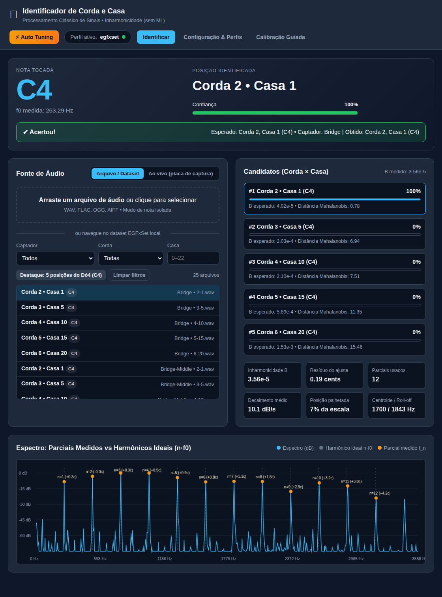
</p>
<p align="center"><em>Main Identify page using EGFxSet audio (Corda 2 • Casa 1, Bridge pickup): shows C4, 100% confidence, green ground-truth match, ranked candidates, physical features, and spectrum.</em></p>

<p align="center">
  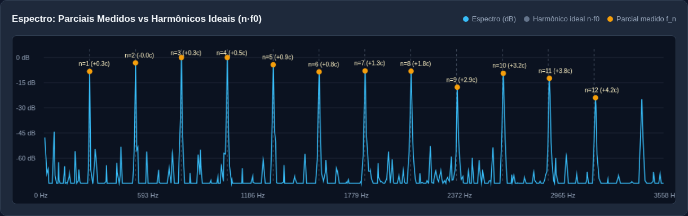
</p>
<p align="center"><em>Spectrum chart (EGFxSet sample): blue curve = FFT spectrum (dB), dashed lines = ideal harmonics n·f0, amber dots = measured partials with upward cent shift.</em></p>

---

## 6. Calibration

**Quick jump inside this chapter:**
- [6.1 What Calibration Is For](#61-what-calibration-is-for)
- [6.2 How Calibration Works in NotesId](#62-how-calibration-works-in-notesid)
- [6.3 When to Calibrate or Recalibrate](#63-when-to-calibrate-or-recalibrate)
- [6.4 Step-by-Step Calibration Tutorials (All 5 Methods)](#64-step-by-step-calibration-tutorials)

### 6.1 What Calibration Is For

Think of calibration like fitting eyeglasses to your specific eyes. Two guitars tuned to the exact same standard `E-A-D-G-B-E` can have very different string stiffness depending on string gauge (`.009` vs. `.011`), plain vs. wound construction, and scale tension. Calibration measures the unique **physical stiffness fingerprint** ($B_0$) of **each of your 6 strings** so NotesId can reliably tell positions apart.

### 6.2 How Calibration Works in NotesId

You only need to play a small set of known notes (by default, **each open string at fret 0 and at fret 12** = 12 notes). For every note, NotesId measures the inharmonicity coefficient $B$ and its fit residual (in [cents](docs/GLOSSARY.md#cents)). Notes with high residuals or too few partials are **automatically rejected**. From the accepted notes, NotesId computes each string's open stiffness $B_0 = B(\text{fret}) / 2^{\text{fret}/6}$ and uses the physical law $B(\text{fret}) = B_0 \cdot 2^{\text{fret}/6}$ to predict $B$ across **all 22 frets**, saving $B_0$, $\sigma(\ln B)$, and decay slopes into your guitar's YAML profile (`configs/profiles/<name>.yaml`).

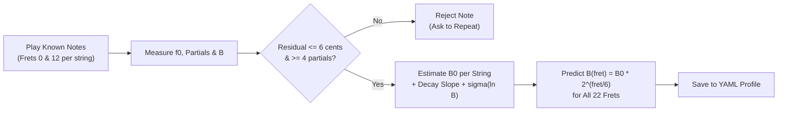

### 6.3 When to Calibrate or Recalibrate

- Setting up a **new guitar** for the first time.
- After **changing strings** (especially changing string gauge or brand).
- After switching to an **alternate tuning** (e.g., Drop D, Eb, DADGAD).
- After changing your **audio interface** or moving to a different room/pickup setup (for noise floor and 60 Hz hum exclusion).

### 6.4 Step-by-Step Calibration Tutorials

NotesId includes **5 calibration workflows**. Choose the one that fits your situation:

| Method | Best for | Hardware needed? |
|---|---|---|
| **1. Auto Tuning — Live Mode** | Your own real guitar (fastest & most complete) | Yes (USB interface + guitar) |
| **2. Auto Tuning — File / Dataset Mode** | Reproducing or tuning on EGFxSet | No (uses local WAV files) |
| **3. Guided Calibration Page** | Calibrating individual notes (live or WAV uploads) | Optional (live or WAV) |
| **4. CLI Calibration (`evaluate.py`)** | Automated dataset calibration + evaluation report | No |
| **5. Manual Profile & Tuning Editing** | Fine-tuning A4, `auto`/`manual` modes, or inspecting $B_0$ | No |

<details>
<summary><strong>Method 1: Auto Tuning Wizard — Live Mode (Recommended for Your Guitar)</strong></summary>

- **When to use:** First-time setup with your own guitar and USB interface. Configures interface, noise floor, 60 Hz hum notches, level/clipping, open-string tuning, A4 reference, $B_0$, decay, and adaptive `auto` analysis in one guided flow.
- **Prerequisites:** Guitar plugged into USB interface (Hi-Z, clean tone), Windows Audio Enhancements OFF, app open at `http://localhost:8000`.

<p align="center">
  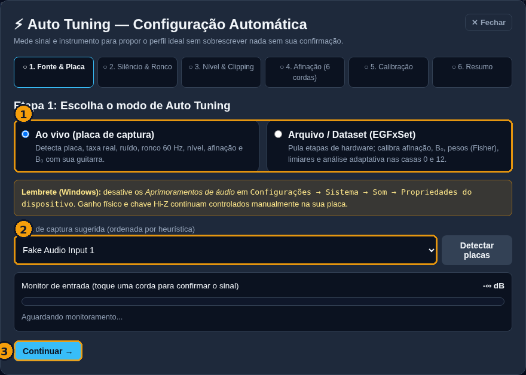
</p>
<p align="center"><em>Auto Tuning Step 1 (captured with Chromium test device). Numbers match Steps 1–3 below.</em></p>

- **Step 1 of 6 (`①` `②` `③`) — Choose Mode and Interface:** Click **⚡ Auto Tuning** in the top bar. Keep **Ao vivo (placa de captura)** selected (`①`), click **Detectar placas**, pick your USB interface (`②`) and pluck a string to confirm the monitor bar moves, then click **Continuar →** (`③`). *What NotesId does:* ranks interfaces by name heuristic, reads actual `sampleRate` and `baseLatency`, and proposes buffer size.
- **Step 2 of 6 — Silence (Noise Floor & 60 Hz Hum):** Keep guitar volume open, **do not touch the strings**, and click **Medir 2 segundos de silêncio**. *What appears:* noise floor in dBFS, suggested onset threshold, and whether 60 Hz / 50 Hz hum was found and excluded. If noise is too loud (> −30 dBFS), check shielding/cables and repeat.
- **Step 3 of 6 — Level & Clipping:** Click **Medir nota forte (1,5 s)** and pluck string 6 firmly. *What appears:* peak dBFS and status (`bom`, `baixo demais`, or `saturando`). Adjust the physical Gain knob on your interface until it reads **bom**, then click **Próximo: Afinação →**.
- **Step 4 of 6 — Click-Free 6-String Tuning:** Click **Iniciar detecção automática** and pluck open strings **6 → 5 → 4 → 3 → 2 → 1** as prompted (no clicking needed). *What appears:* detected note, cents offset, global A4 Hz, and alternate tuning preset (e.g., `Drop D`). Use **Repetir corda atual** if any string misfired.
- **Step 5 of 6 — Click-Free Guided Calibration (Recommended):** Click **Iniciar calibração automática** and play each requested `(string, fret)` (open + fret 12). *What NotesId does:* verifies $f_0$, fits $B$, automatically rejects bad notes (residual > 6 cents), and advances on accepted notes.
- **Step 6 of 6 — Review Proposal & Save:** Inspect the comparison table (current value vs. proposed value vs. how obtained) and warnings. Click **Salvar como novo perfil** (recommended for a new guitar) or **Aplicar ao perfil ativo**. Nothing is overwritten until you click one of those buttons.

<p align="center">
  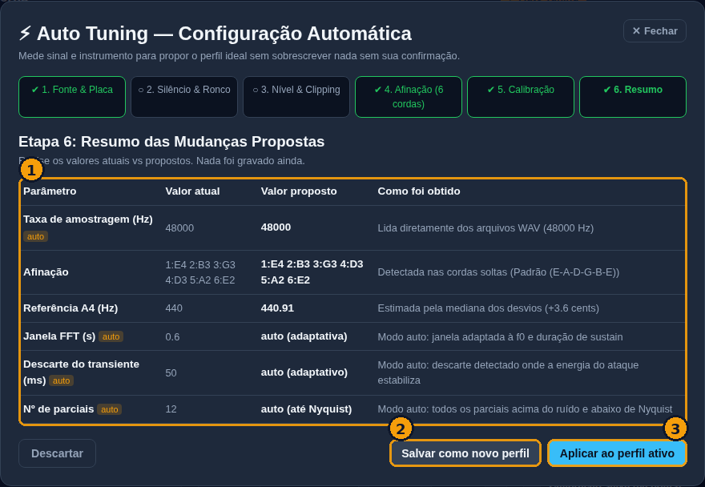
</p>
<p align="center"><em>Auto Tuning Step 6 proposal table (generated on EGFxSet calibration frets 0 & 12). ① Diff table, ② Save as new profile, ③ Apply to active profile.</em></p>

- **How to know it succeeded:** Top-bar calibration dot turns **green**, all 6 strings appear in the calibration summary under **Configuração & Perfis**, and `σ(ln B)` is typically between `0.10` and `0.35`.

</details>

<details>
<summary><strong>Method 2: Auto Tuning Wizard — File / Dataset Mode (EGFxSet)</strong></summary>

- **When to use:** Automatically calibrating and tuning analysis weights/thresholds on the local EGFxSet dataset without hardware.
- **Prerequisites:** EGFxSet downloaded via `uv run python scripts/download_egfxset.py`.
- **Step 1 of 3:** Click **⚡ Auto Tuning** and select **Arquivo / Dataset (EGFxSet)** (`①`).
- **Step 2 of 3:** Keep calibration frets `0 12` (never touching the 21 test frets) and target error rate `0.10` (10%), then click **Continuar →** (`③`). *What NotesId does:* reads sample rate from WAVs, checks open-string tuning, calibrates $B_0$ & decay, estimates Fisher feature weights, runs internal leave-one-pickup-out cross-validation inside frets `0` and `12` to calibrate `min_confidence`/`min_margin`, and enables adaptive `auto` analysis.
- **Step 3 of 3:** Review the proposal table (Step 6 screenshot above) and choose **Aplicar ao perfil ativo**, **Salvar como novo perfil**, or **Descartar**.

</details>

<details>
<summary><strong>Method 3: Guided Calibration Page (Individual Notes — Live or WAV)</strong></summary>

- **When to use:** When you want manual control over each of the 12 calibration notes (live 1.2 s recording OR uploading individual WAV files).
- **Prerequisites:** Active profile selected in **Configuração & Perfis** (create or duplicate one first if calibrating a new guitar).

<p align="center">
  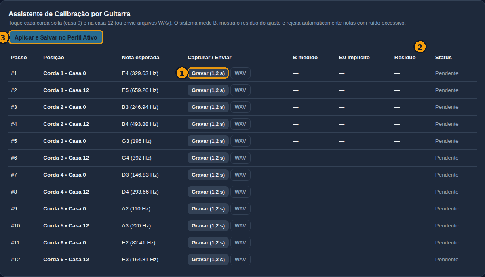
</p>
<p align="center"><em>Guided Calibration tab. ① Record (1.2 s) or upload WAV per note, ② Measured B, implied B0, residual & status, ③ Apply and save to active profile.</em></p>

- **Step 1 of 3 (`①`):** Open the **Calibração Guiada** tab. For each row (strings 1–6, frets 0 and 12), click **Gravar (1,2 s)** and pluck the requested note, OR click **WAV** to upload a recording of that note.
- **Step 2 of 3 (`②`):** Check the **B medido**, **B0 implícito**, **Resíduo**, and **Status** columns. Accepted notes show green **`✔ Aceita`**; noisy or poorly fitted notes show red **`✖ Rejeitada`** with the reason — simply record/upload that row again.
- **Step 3 of 3 (`③`):** Once all 6 strings have accepted notes, click **Aplicar e Salvar no Perfil Ativo**. Confirm the green feedback banner appears and verify the saved $B_0$ values in **Configuração & Perfis**.

</details>

<details>
<summary><strong>Method 4: Command-Line Calibration (`scripts/evaluate.py`)</strong></summary>

- **When to use:** Reproducible offline calibration on EGFxSet + full accuracy report generation.
- **Prerequisites:** EGFxSet downloaded in `data/egfxset/Clean/`.
- **Step 1 of 2:** Run:
  ```bash
  # Bash or PowerShell
  uv run python scripts/evaluate.py --cal-frets 0 12 --save-profile --compare-autotune
  ```
- **Step 2 of 2:** Inspect the terminal summary and [`docs/evaluation.md`](docs/evaluation.md). The calibrated $B_0$ and decay parameters are saved into `configs/profiles/egfxset.yaml` using **only** frets `0` and `12`.

</details>

<details>
<summary><strong>Method 5: Manual Profile & Tuning Editing (`Configuração & Perfis` / YAML)</strong></summary>

- **When to use:** Tweaking tuning, `Ref. A4 (Hz)`, toggling individual parameters between `auto` and `manual`, or inspecting saved calibration constants.

<p align="center">
  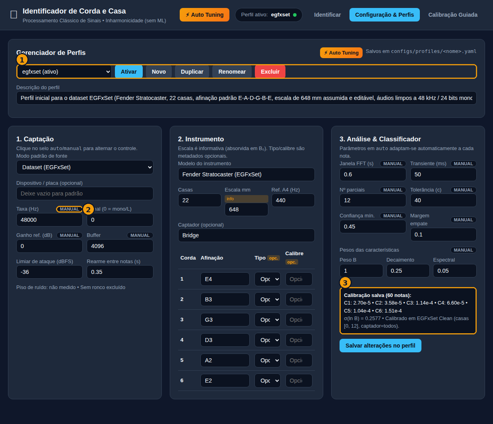
</p>
<p align="center"><em>Configuration & Profiles tab. ① Profile CRUD toolbar, ② auto/manual toggle pills, ③ Saved calibration summary (B0 per string and σ).</em></p>

- **Step 1 of 3 (`①`):** Open **Configuração & Perfis**, select a profile, and use **Ativar**, **Novo**, **Duplicar**, **Renomear**, or **Excluir**.
- **Step 2 of 3 (`②`):** Click any **`auto`** / **`manual`** badge to toggle between adaptive runtime resolution and fixed manual values. Edit `Ref. A4 (Hz)` or individual string notes in Block 2 (*Instrumento*). Note that `Escala mm` is informative only (scale length is absorbed into $B_0$).
- **Step 3 of 3 (`③`):** Check the saved calibration summary box at the bottom of Block 3 and click **Salvar alterações no perfil**. Changes are validated by Pydantic and written to `configs/profiles/<name>.yaml`.

</details>

---

## 7. FAQ and Troubleshooting

- **Status stays "Parado" or level meter doesn't move?** Hard-reload with `Ctrl+F5` to clear cached JS, or open `http://localhost:8000/?debug=1` to inspect `AudioContext.state`, `sampleRate`, and WebSocket events in real time.
- **Microphone blocked on tablet / phone / remote IP?** Browsers only allow `getUserMedia` and `AudioWorklet` on `localhost` or `HTTPS`. Start the server with `uv run guitar-string-identifier --host 0.0.0.0 --https` and open `https://<your-pc-ip>:8000` (see [Section 5.5](#55-using-a-mobile-phone-as-a-microphone-experimental)).
- **Phone cannot open `https://192.168.0.10:8000` (timeout or connection refused)?** Check that (1) PC and phone are on the **same Wi-Fi** (not a guest network with client isolation), (2) the server was started with `--host 0.0.0.0 --https`, (3) port `8000` is allowed in your PC's firewall for Private networks, and (4) if using WSL2, note that default NAT mode blocks LAN access (see the WSL2 note in Section 5.5).
- **Phone shows "Your connection is not private" / certificate warning?** Expected when using `--https` with a locally generated self-signed certificate. Tap **Advanced → Proceed** *only* when connecting to your own PC's local IP — never do this on unknown websites.
- **Page opens on the phone, but microphone won't start?** Confirm the address bar starts with **`https://`** (not `http://`), grant Chrome microphone permission in site settings, and avoid Safari/iOS (untested).
- **Notes on the phone are mostly wrong or show `Indeterminado`?** Expected limitation of airborne phone microphones (room echo, ambient noise, phone voice filters). Move the phone closer to the amp/acoustic guitar in a quiet room, re-run **⚡ Auto Tuning** in that fixed position, or switch to a USB Hi-Z audio interface for reliable accuracy.
- **Bluetooth earbuds/headset connected to the phone?** Turn off Bluetooth. Bluetooth hands-free mic profiles downsample audio to 8–16 kHz, erasing the upper partials needed to measure inharmonicity $B$.
- **USB interface not visible inside WSL?** Expected behavior in WSL2. NotesId captures audio **in your Windows browser** via Web Audio API and streams PCM over WebSocket to WSL2.
- **Sustain cuts off or pitch jumps on Windows?** Turn off Windows **Audio Enhancements** on the input device (they treat guitar sustain as background noise).
- **Heavy 60 Hz hum or noisy room?** Run **⚡ Auto Tuning** so Step 2 detects 60 Hz and its harmonics and excludes them from partial search.
- **Chords rejected?** Intentional: NotesId is designed for **isolated single notes** and warns when polyphony or clipping is detected.

---

## 8. Repository Structure, Tests, and Contributing

```text
├── configs/profiles/egfxset.yaml   # Default Stratocaster profile (calibrated on frets 0 & 12)
├── docs/                           # Technical docs, glossary, evaluation report & images
│   ├── GLOSSARY.md / GLOSSARY.pt-BR.md
│   ├── physics.md                  # Stiff-string physics & B(fret) = B0 * 2^(fret/6)
│   ├── architecture.md             # Interfaces, modules & Web Audio design
│   ├── auto_tuning.md              # Auto Tuning heuristics & REST/WebSocket protocol
│   ├── decisions.md                # Architectural decisions & root-cause logs
│   └── evaluation.md               # Honest Before x After EGFxSet metrics & confusion matrix
├── scripts/                        # download_egfxset.py (pure Python) & evaluate.py
├── src/guitar_string_identifier/   # Core package (core, analysis, synth, sources, profiles,
│                                   # calibration, classifier, autotune, web)
└── tests/                          # Automated unit & integration tests (pytest)
```

```bash
# Run lint (Google docstrings + type hints) and unit tests
uv run ruff check .
uv run pytest

# Reproduce the Before x After evaluation on EGFxSet
uv run python scripts/evaluate.py --cal-frets 0 12 --compare-autotune

# Regenerate requirements.txt after dependency changes
uv export --no-hashes --format requirements-txt -o requirements.txt
```

Contributions are welcome — see [`CONTRIBUTING.md`](CONTRIBUTING.md).

---

## 9. Dataset, Credits, Citation, and License

- **Dataset:** **EGFxSet** — Zenodo record 7044411 ([https://zenodo.org/record/7044411](https://zenodo.org/record/7044411)) | Website: [https://egfxset.github.io](https://egfxset.github.io).
- **Citation:** Pedroza, H., Meza, G., & Roman, I. R. (2022). *EGFxSet: Electric guitar tones processed through real effects of distortion, modulation, delay and reverb*. Zenodo. DOI: `10.5281/zenodo.7044411`.
- **Dataset license:** Creative Commons Attribution 4.0 International (`CC-BY-4.0`). `data/` is excluded from Git (`.gitignore`).
- **Project license:** Released under the **MIT License** — see [`LICENSE`](LICENSE).
