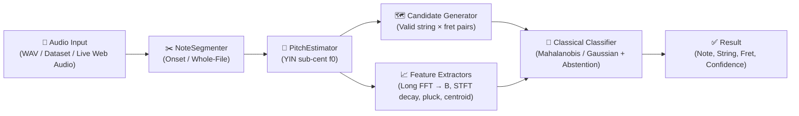
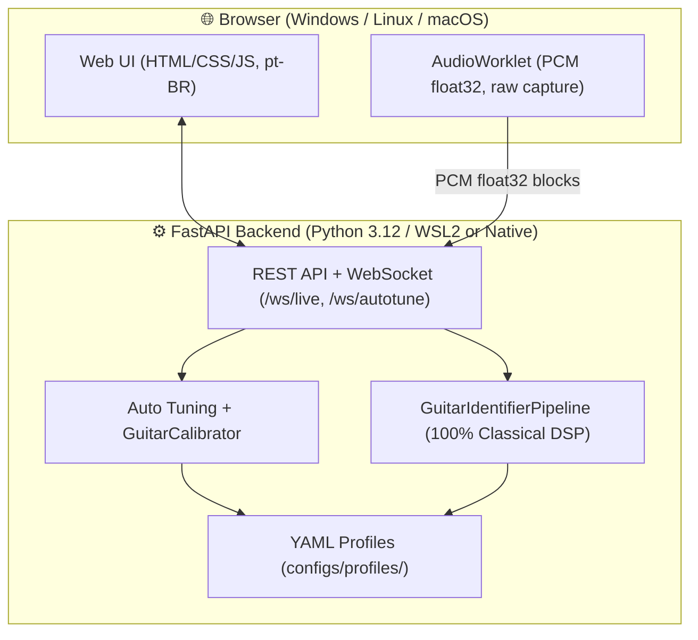
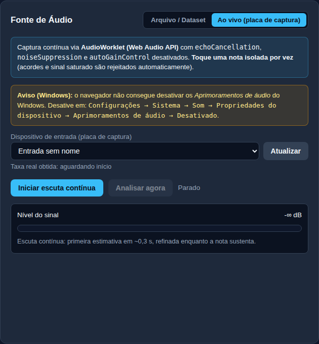
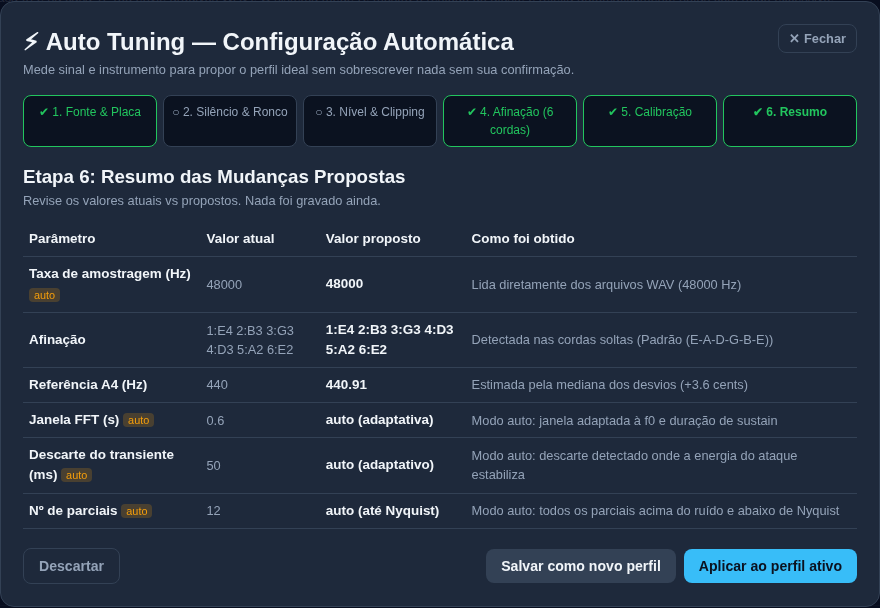

<p align="center">
  🇺🇸 <strong>English</strong> &nbsp;|&nbsp; 🇧🇷 <a href="README.pt-BR.md">Português</a>
</p>

<h1 align="center">🎸 NotesId</h1>

<p align="center">
  <strong>Identifies which guitar string and fret a note was played on — using 100% classical digital signal processing and acoustics physics (zero machine learning).</strong>
</p>

<p align="center">
  <a href="https://github.com/lucasrech/NotesId/actions/workflows/ci.yml">
    
  </a>
  
  
  
  
  
  
  
  
  <a href="LICENSE">
    
  </a>
</p>

> **Package note:** the public project name is **NotesId**, while the internal Python package name is `guitar_string_identifier` (kept for stable imports). New to terms like *f0*, *partials*, *inharmonicity*, *FFT*, or *cents*? Read the plain-language [**Glossary**](docs/GLOSSARY.md).

---

## 🎯 1. What Is NotesId & What Problem Does It Solve?

On a piano, middle C (`C4`, ~261.63 Hz) exists in only **one** key. On a standard 6-string guitar, **the exact same C4 can be played in 5 different places**:

| String | Fret | Physical feel | Measured inharmonicity $B$ (Stratocaster) |
|---:|---:|---|---:|
| 2 (B3) | 1 | Thin, long plain steel string | `3.4 × 10⁻⁵` |
| 3 (G3) | 5 | Thicker plain steel string | `2.0 × 10⁻⁴` |
| 4 (D3) | 10 | Wound string, medium length | `1.9 × 10⁻⁴` |
| 5 (A2) | 15 | Thick wound string, short | `4.4 × 10⁻⁴` |
| 6 (E2) | 20 | Thickest wound string, very short | `1.5 × 10⁻³` |

A regular tuner only tells you *"you played C4"*. **NotesId** tells you **which string and which fret** produced that note — without neural networks or machine learning, relying purely on string physics and classical DSP.

---

## 🔬 2. How It Works (For Non-Specialists)

Imagine bending a soft shoelace versus a thin metal rod. The metal rod resists tight bends and snaps back faster. Real steel guitar strings have **bending stiffness**: their upper overtones (**partials**) vibrate slightly sharper than exact integer multiples of the fundamental frequency ($f_0$):

$$f_n = n \cdot f_0 \cdot \sqrt{1 + B \cdot n^2}$$

That tiny number $B$ (**inharmonicity**) grows rapidly as a string gets shorter ($B(\text{fret}) = B_0 \cdot 2^{\text{fret}/6}$), acting as a **physical fingerprint** for each `(string, fret)` position. NotesId measures $f_0$, tracks the real partials with a high-resolution FFT, fits $B$ robustly, combines it with per-partial decay rates (STFT) and low-weight spectral cues, and ranks only the physically valid `(string, fret)` candidates using a classical Gaussian / Mahalanobis classifier.

### Processing Pipeline



### System Architecture



---

## ✨ 3. Key Features

- **100% Classical DSP (Zero ML):** YIN pitch detection, Blackman-Harris long FFT with 4× zero-padding, parabolic peak interpolation, progressive partial tracking, robust Huber IRLS fit for $B$, STFT decay rates, and Gaussian/Mahalanobis classification with explicit **`indeterminate`** abstention on ties.
- **Interactive Web Interface:** large central note/string/fret/confidence display, dataset browser with automatic ground-truth verification (`LabelProvider`), WAV/FLAC/OGG upload, and live spectrum chart comparing measured partials against ideal harmonics $n \cdot f_0$.
- **Live Browser Capture (`AudioWorklet`):** runs natively in the browser with `echoCancellation`, `noiseSuppression`, and `autoGainControl` disabled — ideal for WSL2 where Linux cannot reliably access Windows USB audio interfaces. Features continuous progressive refinement (~0.3 s → ~0.95 s) and rejects chords & clipped signals.
- **Profiles & Guided Calibration:** Pydantic-validated YAML profiles with 3 configurable blocks (`Capture`, `Instrument`, `Analysis`), per-parameter `auto`/`manual` modes, and a guided calibration wizard (open strings + fret 12).
- **⚡ Auto Tuning Wizard:** automatically ranks audio interfaces, measures 2 s of silence (noise floor + 50/60 Hz mains hum exclusion), checks clipping/level, detects open-string tuning & alternate tunings (`Drop D`, `Eb`, `DADGAD`, `A4` reference), calibrates $B_0$, and estimates classical Fisher weights & decision thresholds — always showing a side-by-side proposal before saving.
- **Synthetic Stiff-String Generator:** Karplus-Strong waveguide with all-pass dispersion filter to validate $f_0$ and $B$ recovery on known ground truth.

---

## 📊 4. Honest Evaluation Results (EGFxSet Clean)

All parameters (`B0`, decay model, Fisher weights, and confidence thresholds) were calibrated **strictly on frets `0` and `12` only** (60 files) and evaluated on the **21 held-out frets** (**630 unseen files**, 585 of which have ≥ 2 ambiguous positions) across all 5 Stratocaster pickups. Full tables and confusion matrix: [`docs/evaluation.md`](docs/evaluation.md).

| Metric (630 unseen test notes) | Baseline (Manual) | After Auto Tuning | Delta |
|---|---:|---:|---:|
| Note identification ($f_0$) | 99.8% | **99.8%** | +0.0 pp |
| String + fret — Top-1 overall | 85.1% | **87.0%** | **+1.9 pp** |
| String + fret — Decided (≤ 10% target error) | 86.2% (97.8% cov.) | **90.4%** (92.4% cov.) | **+4.2 pp** |
| Ambiguous notes only (≥ 2 positions) — Top-1 | 83.9% | **86.0%** | **+2.1 pp** |
| Ambiguous notes only — Decided | 85.1% (97.6% cov.) | **89.6%** (91.8% cov.) | **+4.5 pp** |
| **Spotlight: 5 positions of C4** (5 pickups × 5 pos.) | 20/25 (80%) | **21/25 (84%)** | **+4.0 pp** |

> **Known physical limitation — `(string 3, fret 5)` vs. `(string 4, fret 10)` on C4:** on standard electric strings, string 3 (G3) is thick **plain** steel while string 4 (D3) is a **wound** string with a thinner steel core. As a result, string 3 has higher open-string stiffness $B_0$ than string 4, causing their predicted $B$ values at `(3, 5)` and `(4, 10)` to nearly coincide (~3% difference vs. ~26% empirical spread). Consequently, `(4, 10)` remains the hardest position (2/5), and NotesId relies on its `indeterminate` abstention flag to avoid overconfident errors. Other scope limits: evaluated on one reference guitar (Stratocaster), **isolated single notes** only, and **clean (dry) tone**.

---

## 🚀 5. Step-by-Step Beginner Tutorial

### Prerequisites
- **Windows:** install [WSL2 with Ubuntu 24.04](https://learn.microsoft.com/en-us/windows/wsl/install) (`wsl --install -d Ubuntu-24.04`).
- **Linux / macOS / WSL Ubuntu:** install `git`, `libsndfile1` (`sudo apt install libsndfile1`), and [`uv`](https://docs.astral.sh/uv/getting-started/installation/):
  ```bash
  curl -LsSf https://astral.sh/uv/install.sh | sh
  ```

### Installation & Running
```bash
# 1. Clone the repository
git clone https://github.com/lucasrech/NotesId.git
cd NotesId

# 2. Create the Python 3.12 virtual environment and install dependencies
uv sync

# 3. (Optional) Download the clean EGFxSet dataset (~431 MB, MD5 verified)
uv run python scripts/download_egfxset.py

# 4. Launch the web interface
uv run guitar-string-identifier
```

Open **http://localhost:8000** in your browser (works directly from Windows when running inside WSL2).

### Exploring the Interface

1. **Identify Page (`Identificar`):** upload a WAV/FLAC/OGG file or browse the local EGFxSet dataset. Click **"Destaque: 5 posições do Dó4 (C4)"** to compare all 5 C4 positions with instant green/red ground-truth feedback:
   

2. **Spectrum & Partials Chart:** shows measured peaks ($f_n$, amber dots with cent shift) versus ideal harmonics ($n \cdot f_0$, dashed lines):
   

3. **Live Capture Mode (`Ao vivo`):** select your audio interface, monitor input level & clipping, and play isolated notes continuously:
   

4. **Configuration & Profiles (`Configuração & Perfis`):** edit Capture, Instrument, and Analysis blocks, toggle `auto`/`manual` per parameter, and manage YAML profiles:
   

5. **Guided Calibration (`Calibração Guiada`) & ⚡ Auto Tuning:** calibrate your own guitar in ~1 minute and review the non-destructive proposal table before applying:
   
   

### Using Your Own Guitar (Live)
1. Plug your guitar into a USB audio interface using the **Hi-Z / Instrument** input (clean/dry signal, no distortion/reverb).
2. On Windows, disable **Audio Enhancements** (`Settings → System → Sound → Device properties → Audio enhancements → Off`).
3. Open **http://localhost:8000**, click **⚡ Auto Tuning**, pick **Ao vivo**, follow the 6 steps (device → 2 s silence → loud note → 6 open strings → open/12th-fret calibration → review), and click **Save as new profile**.
4. Switch to **Ao vivo (placa de captura)**, click **Iniciar escuta contínua**, and play isolated notes (~0.8–1.0 s sustain).

---

## 📦 6. Dataset (EGFxSet)

- **Source:** Zenodo record 7044411 ([https://zenodo.org/record/7044411](https://zenodo.org/record/7044411)) | Website: [https://egfxset.github.io](https://egfxset.github.io)
- **Citation:** Pedroza, H., Meza, G., & Roman, I. R. (2022). *EGFxSet: Electric guitar tones processed through real effects of distortion, modulation, delay and reverb*. Zenodo. DOI: `10.5281/zenodo.7044411`.
- **License:** Creative Commons Attribution 4.0 International (`CC-BY-4.0`).
- **Note:** `data/` is excluded from Git (`.gitignore`). Use `uv run python scripts/download_egfxset.py` to download the 690 clean 48 kHz / 24-bit WAV files (`Clean.zip`, 431 MB) with resume and MD5 checksum verification.

---

## ❓ 7. FAQ & Troubleshooting

- **Microphone blocked on tablet / phone / remote IP?** Browsers only allow `getUserMedia` and `AudioWorklet` on `localhost` or `HTTPS`. Access from `http://localhost:8000` on the same machine, or put an HTTPS proxy in front for remote devices.
- **USB audio interface not showing up in WSL?** That is expected: WSL2 does not reliably expose Windows USB/ASIO interfaces to Linux. NotesId solves this by capturing audio **in your Windows browser** via Web Audio API and streaming PCM over WebSocket to WSL2.
- **Wrong note / choppy sustain on Windows?** Turn off Windows **Audio Enhancements** on the capture device (they mistake guitar sustain for background noise).
- **High 60 Hz hum or noisy room?** Run **⚡ Auto Tuning** so the silence step detects and excludes 60 Hz (and harmonics) from partial tracking.
- **Chords or fast strumming rejected?** By design: NotesId is built for **isolated single notes** and explicitly rejects chords and clipped signals instead of guessing.

---

## 🗂️ 8. Repository Structure, Tests & Contributing

```text
├── configs/profiles/egfxset.yaml   # Default Stratocaster profile (calibrated on frets 0 & 12)
├── docs/                           # Technical docs, glossary, evaluation report & screenshots
│   ├── GLOSSARY.md / GLOSSARY.pt-BR.md
│   ├── physics.md                  # Stiff-string physics & B(fret) = B0 * 2^(fret/6)
│   ├── architecture.md             # Interfaces, modules & WSL2 Web Audio design
│   ├── auto_tuning.md              # Auto Tuning heuristics & REST/WebSocket protocol
│   ├── decisions.md                # Architectural decisions & known issues
│   └── evaluation.md               # Honest before/after EGFxSet metrics & confusion matrix
├── scripts/                        # download_egfxset.py & evaluate.py
├── src/guitar_string_identifier/   # Core package (core, analysis, synth, sources, profiles,
│                                   # calibration, classifier, autotune, web)
└── tests/                          # Automated unit & integration tests (pytest)
```

```bash
# Run lint (including Google-style docstrings & type annotations) and unit tests
uv run ruff check .
uv run pytest

# Reproduce the Before × After evaluation on EGFxSet
uv run python scripts/evaluate.py --cal-frets 0 12 --compare-autotune

# Regenerate requirements.txt after dependency changes
uv export --no-hashes --format requirements-txt -o requirements.txt
```

Contributions are welcome — see [`CONTRIBUTING.md`](CONTRIBUTING.md).

---

## 🗺️ 9. Limitations & Roadmap

- **Current limitations:** single isolated notes only; clean/dry signal (no heavy overdrive/reverb); evaluated on a single electric guitar (EGFxSet Stratocaster); `(3, 5)` vs. `(4, 10)` physical stiffness crossover.
- **Roadmap:** per-pickup timbre templates to further separate `(3, 5)` vs. `(4, 10)`, multi-guitar benchmark dataset, robustness testing under light modulation/reverb effects, and fixing the minor `AudioContext.sampleRate` fallback preference in `app.js` (documented in `docs/decisions.md`).

---

## 🙏 10. Credits & License

- Dataset courtesy of **Hegel Pedroza, Gerardo Meza, and Iran R. Roman** ([EGFxSet](https://zenodo.org/record/7044411), CC-BY-4.0).
- Released under the **MIT License** — see [`LICENSE`](LICENSE).
