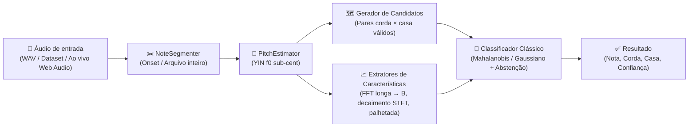
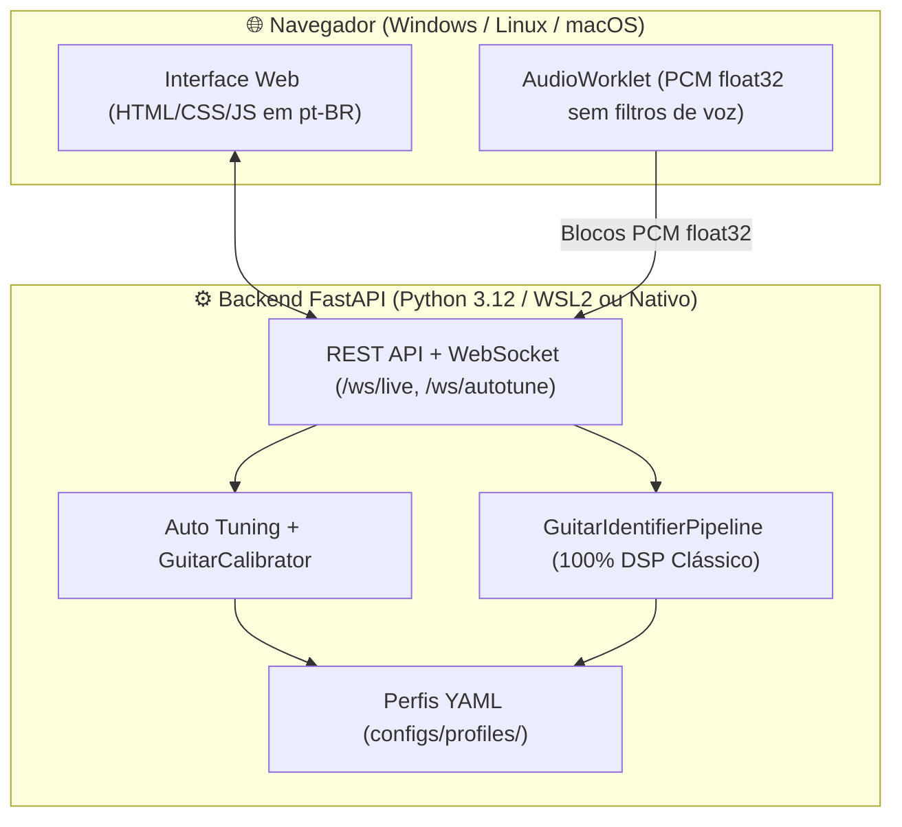
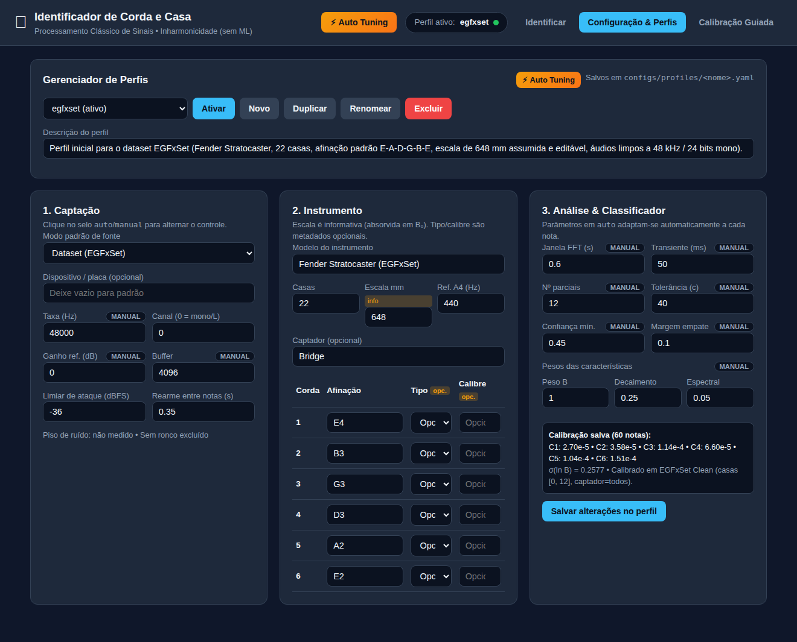
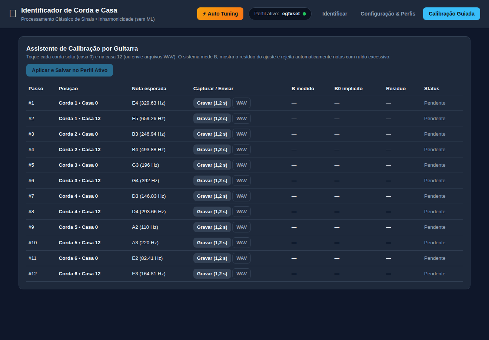

<p align="center">
  🇺🇸 <a href="README.md">English</a> &nbsp;|&nbsp; 🇧🇷 <strong>Português</strong>
</p>

<h1 align="center">🎸 NotesId</h1>

<p align="center">
  <strong>Identifica em qual corda e qual casa uma nota de guitarra foi tocada — usando 100% processamento clássico de sinais e física acústica (zero machine learning).</strong>
</p>

<p align="center">
  <a href="https://github.com/lucasrech/NotesId/actions/workflows/ci.yml">
    
  </a>
  
  
  
  
  
  
  
  
  <a href="LICENSE">
    
  </a>
</p>

> **Nota sobre o pacote:** o nome público do projeto é **NotesId**, enquanto o pacote Python interno permanece `guitar_string_identifier` (mantido para não quebrar imports). Novo em termos como *f0*, *parciais*, *inharmonicidade*, *FFT* ou *cents*? Consulte o [**Glossário para leigos**](docs/GLOSSARY.pt-BR.md).

---

## 🎯 1. O que é o NotesId e qual problema ele resolve?

Num piano, o Dó central (`C4`, ~261,63 Hz) existe em apenas **uma** tecla. Numa guitarra de 6 cordas em afinação padrão, **o mesmo Dó4 pode ser tocado em 5 posições diferentes**:

| Corda | Casa | Característica física | Inharmonicidade $B$ medida (Stratocaster) |
|---:|---:|---|---:|
| 2 (B3) | 1 | Corda lisa fina e comprida | `3,4 × 10⁻⁵` |
| 3 (G3) | 5 | Corda lisa mais grossa | `2,0 × 10⁻⁴` |
| 4 (D3) | 10 | Corda encapada, comprimento médio | `1,9 × 10⁻⁴` |
| 5 (A2) | 15 | Corda encapada grossa e curta | `4,4 × 10⁻⁴` |
| 6 (E2) | 20 | Corda mais grossa e curtíssima | `1,5 × 10⁻³` |

Um afinador comum só consegue dizer *"você tocou Dó4"*. O **NotesId** descobre **em qual corda e em qual casa** essa nota foi tocada — sem redes neurais nem machine learning, usando apenas física de cordas e processamento clássico de sinais.

---

## 🔬 2. Como funciona (em linguagem simples)

Imagine dobrar um barbante macio versus uma barra fina de ferro: a barra "resiste" a curvas apertadas e volta mais rápido. Uma corda real de guitarra feita de aço tem **rigidez à flexão**, fazendo com que seus sobretons agudos (**parciais**) vibrem um pouco mais altos do que múltiplos inteiros exatos da frequência fundamental ($f_0$):

$$f_n = n \cdot f_0 \cdot \sqrt{1 + B \cdot n^2}$$

Esse número $B$ (**inharmonicidade**) cresce rapidamente conforme a corda encurta ($B(\text{casa}) = B_0 \cdot 2^{\text{casa}/6}$) e funciona como uma **"impressão digital física"** de cada posição `(corda, casa)`. O NotesId mede $f_0$, rastreia os parciais reais via FFT de alta resolução, ajusta $B$ de forma robusta, combina com a velocidade de decaimento de cada parcial (STFT) e pistas espectrais de baixo peso, e ranqueia apenas os candidatos fisicamente possíveis com um classificador clássico Gaussiano / Mahalanobis.

### Fluxo do Pipeline



### Arquitetura do Sistema



---

## ✨ 3. Funcionalidades

- **100% DSP Clássico (zero ML):** estimativa de $f_0$ via YIN, FFT longa com janela Blackman-Harris e zero-padding $4\times$, interpolação parabólica, rastreamento progressivo de parciais, ajuste robusto IRLS (Huber) de $B$, taxas de decaimento na STFT e classificador Gaussiano/Mahalanobis com abstenção explícita (`indeterminado`) em caso de empate.
- **Interface Web em pt-BR:** quadro grande e central de nota, corda, casa e confiança, navegador do dataset EGFxSet com conferência automática de acerto (`LabelProvider`), upload de WAV/FLAC/OGG e gráfico do espectro comparando parciais medidos contra harmônicos ideais $n \cdot f_0$.
- **Captura ao vivo no navegador (`AudioWorklet`):** roda direto no navegador com `echoCancellation`, `noiseSuppression` e `autoGainControl` desativados — ideal para o WSL2, onde o Linux não acessa com confiabilidade placas USB do Windows. Faz resposta progressiva (~0,3 s → ~0,95 s) e rejeita acordes e sinal saturado.
- **Perfis YAML e Calibração Guiada:** 3 blocos editáveis (`Captação`, `Instrumento`, `Análise`), selos `auto`/`manual` por parâmetro e assistente de calibração (cordas soltas + casa 12).
- **⚡ Assistente Auto Tuning:** ordena placas de captura por heurística, mede 2 s de silêncio (piso de ruído + exclusão de ronco 50/60 Hz), verifica nível/clipping, detecta sem cliques a afinação das 6 cordas (incluindo `Drop D`, `Eb`, `DADGAD` e referência `A4`), calibra $B_0$ e estima pesos (critério de Fisher) e limiares — sempre apresentando uma proposta antes de salvar.
- **Gerador Sintético de Corda Rígida:** Karplus-Strong com filtro *all-pass* de dispersão para validar a recuperação de $f_0$ e $B$ em laboratório.

---

## 📊 4. Resultados Honesto (EGFxSet Clean)

Todos os parâmetros ($B_0$, modelo de decaimento, pesos de Fisher e limiares de confiança) foram calibrados **exclusivamente nas casas `0` e `12`** (60 arquivos) e avaliados nas **21 casas inéditas restantes** (**630 arquivos**, sendo 585 em regiões ambíguas com ≥ 2 posições possíveis) nos 5 captadores da Stratocaster. Relatório completo e matriz de confusão: [`docs/evaluation.md`](docs/evaluation.md).

| Métrica (630 notas inéditas de teste) | Baseline (Manual) | Depois (Auto Tuning) | Variação |
|---|---:|---:|---:|
| Identificação da nota ($f_0$) | 99,8% | **99,8%** | +0,0 pp |
| Corda + casa — Top-1 geral | 85,1% | **87,0%** | **+1,9 pp** |
| Corda + casa — Decidido (erro alvo ≤ 10%) | 86,2% (cob. 97,8%) | **90,4%** (cob. 92,4%) | **+4,2 pp** |
| Apenas notas ambíguas (≥ 2 posições) — Top-1 | 83,9% | **86,0%** | **+2,1 pp** |
| Apenas notas ambíguas — Decidido | 85,1% (cob. 97,6%) | **89,6%** (cob. 91,8%) | **+4,5 pp** |
| **Destaque: 5 posições do Dó4** (5 captadores × 5 pos.) | 20/25 (80%) | **21/25 (84%)** | **+4,0 pp** |

> **Ponto fraco conhecido — `(corda 3, casa 5)` vs `(corda 4, casa 10)` no Dó4:** em encordoamentos padrão de guitarra elétrica, a corda 3 (G3) é de aço **liso** grosso enquanto a corda 4 (D3) é **encapada** com núcleo interno mais fino. Por isso a corda 3 tem rigidez $B_0$ maior que a 4, fazendo com que $B$ previsto em `(3, 5)` e `(4, 10)` quase coincida (~3% de diferença contra ~26% de dispersão). Assim, `(4, 10)` continua sendo a posição mais difícil (2/5), e o NotesId usa a abstenção `indeterminado` para não chutar com falsa confiança. Outras limitações: avaliado em uma única guitarra de referência (Stratocaster), **apenas nota isolada** e **som limpo**.

---

## 🚀 5. Tutorial Passo a Passo para Leigos

### Pré-requisitos
- **Windows:** instale o [WSL2 com Ubuntu 24.04](https://learn.microsoft.com/pt-br/windows/wsl/install) (`wsl --install -d Ubuntu-24.04`).
- **Linux / macOS / Ubuntu no WSL:** instale `git`, `libsndfile1` (`sudo apt install libsndfile1`) e o [`uv`](https://docs.astral.sh/uv/getting-started/installation/):
  ```bash
  curl -LsSf https://astral.sh/uv/install.sh | sh
  ```

### Instalação e Execução
```bash
# 1. Clonar o repositório
git clone https://github.com/lucasrech/NotesId.git
cd NotesId

# 2. Criar ambiente Python 3.12 e instalar dependências
uv sync

# 3. (Opcional) Baixar os áudios limpos do dataset EGFxSet (~431 MB, verificado por MD5)
uv run python scripts/download_egfxset.py

# 4. Subir a interface web
uv run guitar-string-identifier
```

Abra **http://localhost:8000** no navegador (no Windows funciona direto mesmo rodando no WSL2).

### Conhecendo cada tela

1. **Página principal (`Identificar`):** envie um WAV/FLAC/OGG ou navegue no EGFxSet local. Clique em **"Destaque: 5 posições do Dó4 (C4)"** para testar as 5 posições com conferência automática verde/vermelha:
   

2. **Gráfico do Espectro e Parciais:** compara os picos reais ($f_n$, pontos âmbar com desvio em cents) aos harmônicos ideais ($n \cdot f_0$, linhas tracejadas):
   

3. **Modo Ao Vivo:** escolha sua placa de captura, monitore nível e clipping e toque notas isoladas continuamente:
   

4. **Configuração & Perfis:** ajuste os blocos Captação, Instrumento e Análise, alterne `auto`/`manual` por parâmetro e gerencie perfis YAML:
   

5. **Calibração Guiada e ⚡ Auto Tuning:** calibre sua própria guitarra em ~1 minuto e revise a proposta lado a lado antes de aplicar:
   
   

### Como usar com a sua própria guitarra
1. Ligue a guitarra na entrada **Hi-Z / Instrumento** da sua interface de áudio USB (som limpo, sem distorção ou reverb).
2. No Windows, desative os **Aprimoramentos de áudio** (`Configurações → Sistema → Som → Propriedades do dispositivo → Aprimoramentos de áudio → Desativado`).
3. Abra **http://localhost:8000**, clique em **⚡ Auto Tuning**, escolha **Ao vivo**, siga as 6 etapas (placa → 2 s silêncio → nota forte → 6 cordas soltas → calibração casa 0/12 → resumo) e clique em **Salvar como novo perfil**.
4. Volte para **Identificar → Ao vivo (placa de captura)**, clique em **Iniciar escuta contínua** e toque notas isoladas deixando soar ~0,8–1,0 s.

---

## 📦 6. Dataset (EGFxSet)

- **Fonte:** Zenodo registro 7044411 ([https://zenodo.org/record/7044411](https://zenodo.org/record/7044411)) | Site: [https://egfxset.github.io](https://egfxset.github.io)
- **Citação:** Pedroza, H., Meza, G., & Roman, I. R. (2022). *EGFxSet: Electric guitar tones processed through real effects of distortion, modulation, delay and reverb*. Zenodo. DOI: `10.5281/zenodo.7044411`.
- **Licença:** Creative Commons Attribution 4.0 International (`CC-BY-4.0`).
- **Importante:** a pasta `data/` fica fora do Git (`.gitignore`). Use `uv run python scripts/download_egfxset.py` para baixar os 690 arquivos WAV limpos (48 kHz / 24 bits, `Clean.zip`, 431 MB) com retomada e verificação MD5.

---

## ❓ 7. Perguntas Frequentes e Solução de Problemas

- **Microfone bloqueado no tablet/celular ou por IP da rede?** Navegadores só liberam `getUserMedia` e `AudioWorklet` em `localhost` ou `HTTPS`. Acesse por `http://localhost:8000` no mesmo computador, ou use um proxy HTTPS na rede local.
- **Minha placa USB não aparece dentro do WSL?** É comportamento esperado do WSL2. Por isso o NotesId captura o áudio **no navegador do Windows** via Web Audio API e envia PCM por WebSocket ao backend no WSL2.
- **Nota errada ou sustain cortado no Windows?** Desative os **Aprimoramentos de áudio** do Windows na placa de captura (eles confundem o sustain da guitarra com ruído de fundo).
- **Muito ronco de 60 Hz ou ruído?** Rode o **⚡ Auto Tuning**: a etapa de silêncio detecta 60 Hz e seus harmônicos e exclui essas faixas da busca de parciais.
- **Acordes são rejeitados?** Sim, por projeto: o NotesId opera em modo de **nota isolada** e avisa ao detectar acordes ou clipping em vez de chutar.

---

## 🗂️ 8. Estrutura do Repositório, Testes e Contribuição

```text
├── configs/profiles/egfxset.yaml   # Perfil Stratocaster padrão (calibrado nas casas 0 e 12)
├── docs/                           # Documentação técnica, glossário, avaliação e capturas
│   ├── GLOSSARY.pt-BR.md / GLOSSARY.md
│   ├── physics.md                  # Física da corda rígida e B(casa) = B0 * 2^(casa/6)
│   ├── architecture.md             # Interfaces, módulos e captura Web Audio no WSL2
│   ├── auto_tuning.md              # Heurísticas do Auto Tuning e protocolo REST/WebSocket
│   ├── decisions.md                # Decisões técnicas e problemas conhecidos
│   └── evaluation.md               # Resultados Antes × Depois e matriz de confusão
├── scripts/                        # download_egfxset.py e evaluate.py
├── src/guitar_string_identifier/   # Pacote principal (core, analysis, synth, sources, profiles,
│                                   # calibration, classifier, autotune, web)
└── tests/                          # Testes unitários e de integração (pytest)
```

```bash
# Rodar lint (com docstrings Google e anotações de tipo) e testes
uv run ruff check .
uv run pytest

# Reproduzir a avaliação Antes × Depois no EGFxSet
uv run python scripts/evaluate.py --cal-frets 0 12 --compare-autotune

# Regenerar requirements.txt ao alterar dependências
uv export --no-hashes --format requirements-txt -o requirements.txt
```

Contribuições são bem-vindas — veja [`CONTRIBUTING.md`](CONTRIBUTING.md).

---

## 🗺️ 9. Limitações e Próximos Passos

- **Limitações atuais:** apenas notas isoladas; sinal limpo (sem overdrive/reverb pesados); avaliado em uma única guitarra de referência (Stratocaster do EGFxSet); cruzamento físico de rigidez entre `(3, 5)` e `(4, 10)`.
- **Próximos passos:** perfis de timbre por captador para separar melhor `(3, 5)` vs `(4, 10)`, benchmark multi-guitarras, testes sob efeitos leves e correção da preferência de `audioCtx.sampleRate` em `app.js` (registrada em `docs/decisions.md`).

---

## 🙏 10. Créditos e Licença

- Dataset cedido por **Hegel Pedroza, Gerardo Meza e Iran R. Roman** ([EGFxSet](https://zenodo.org/record/7044411), CC-BY-4.0).
- Distribuído sob a **Licença MIT** — veja [`LICENSE`](LICENSE).
