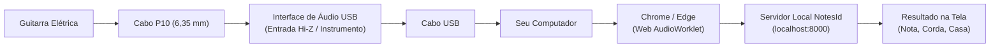
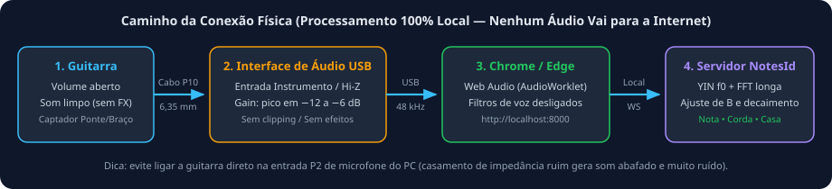
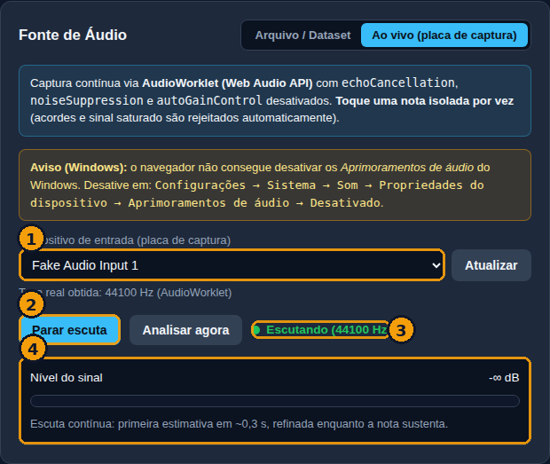
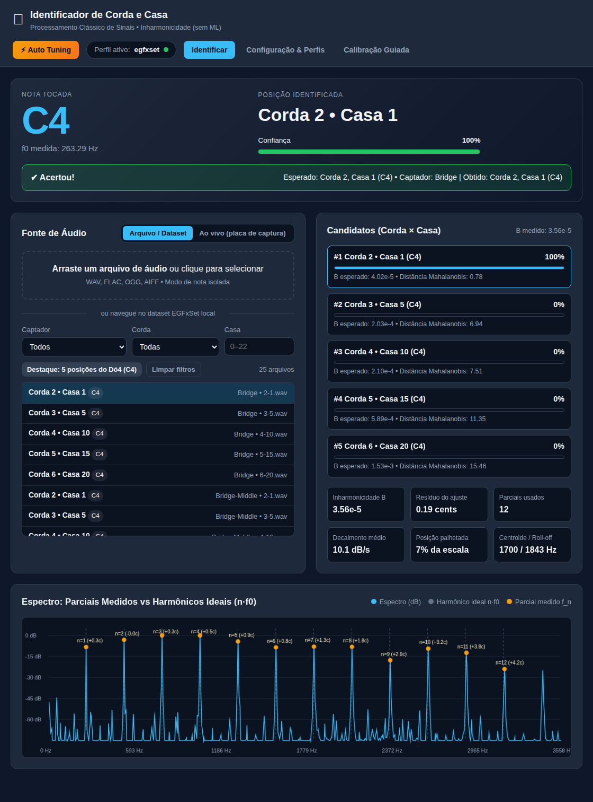
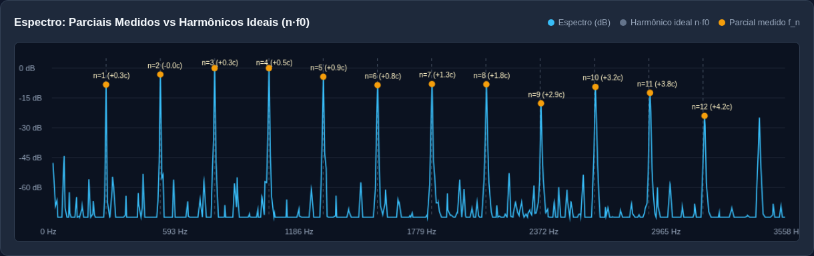
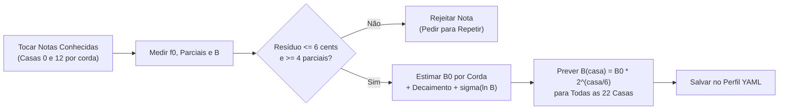
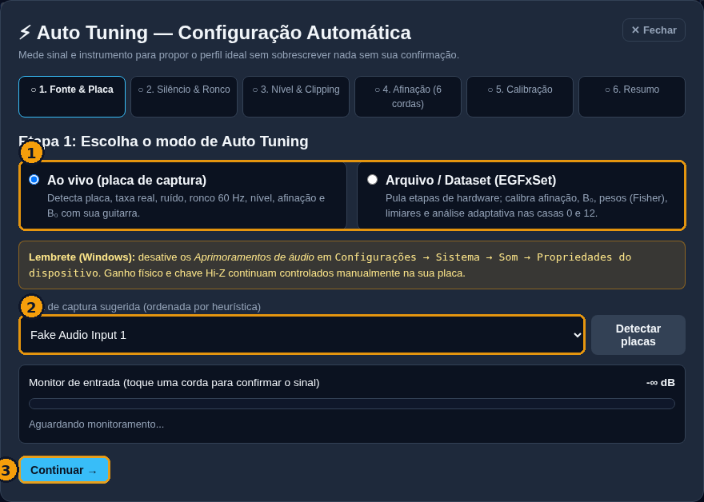
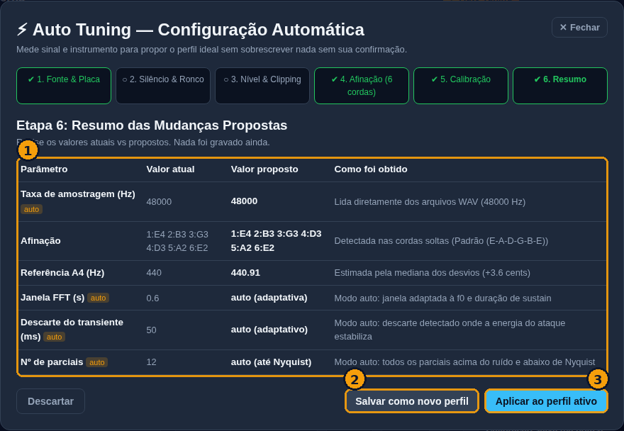
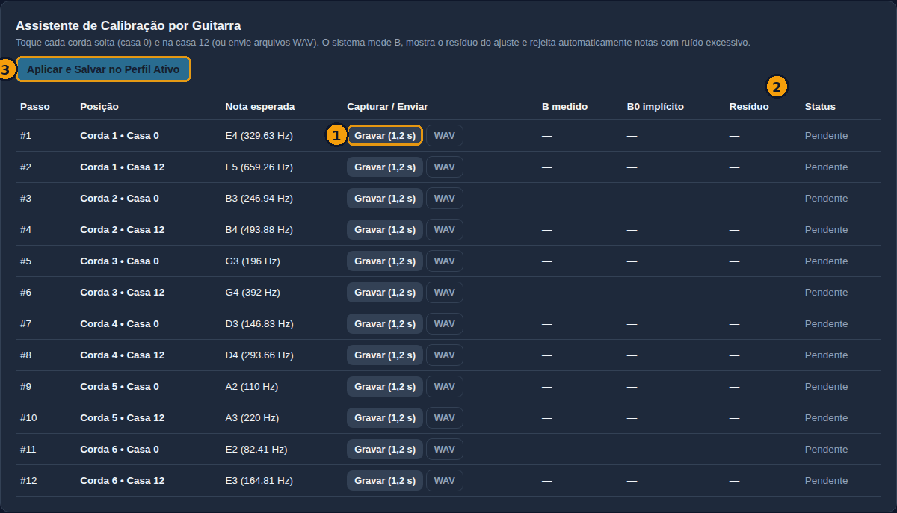
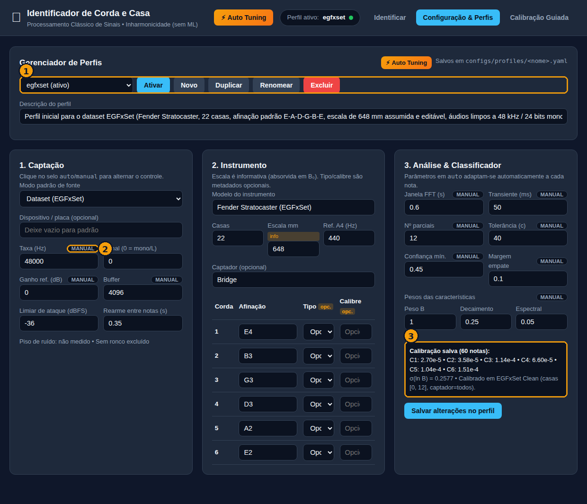

<p align="center">
  🇺🇸 <a href="README.md">English</a> &nbsp;|&nbsp; 🇧🇷 <strong>Português</strong>
</p>

<h1 align="center">🎸 NotesId</h1>

<p align="center">
  <strong>Identifica em qual corda e qual casa uma nota de guitarra foi tocada — usando 100% processamento clássico de sinais e física acústica (zero machine learning).</strong>
</p>

<p align="center">
  <a href="https://github.com/lucasrech/NotesId/actions/workflows/ci.yml">
    
  </a>
  
  
  
  
  
  
  
  
  <a href="LICENSE">
    
  </a>
</p>

> [!NOTE]
> **Nome do pacote e glossário:** O nome público do projeto é **NotesId**, enquanto o pacote Python interno permanece `guitar_string_identifier` (mantido para não quebrar imports). Novo em termos como *f0*, *parciais*, *inharmonicidade*, *FFT* ou *cents*? Consulte o [**Glossário para leigos**](docs/GLOSSARY.pt-BR.md).

## Sumário

1. [O que é o NotesId](#1-o-que-é-o-notesid)
2. [Como funciona](#2-como-funciona)
3. [Funcionalidades](#3-funcionalidades)
4. [Resultados e limitações](#4-resultados-e-limitações)
5. [Tutorial](#5-tutorial)
6. [Calibração](#6-calibração)
7. [Perguntas frequentes e solução de problemas](#7-perguntas-frequentes-e-solução-de-problemas)
8. [Estrutura do repositório, testes e como contribuir](#8-estrutura-do-repositório-testes-e-como-contribuir)
9. [Dataset, créditos, citação e licença](#9-dataset-créditos-citação-e-licença)

---

## 1. O que é o NotesId

Num piano, o Dó central (`C4`, ~261,63 Hz) existe em apenas **uma** tecla. Numa guitarra de 6 cordas em afinação padrão, **o mesmo Dó4 pode ser tocado em 5 posições diferentes**:

| Corda | Casa | Sensação física | Inharmonicidade $B$ medida (Stratocaster) |
|---:|---:|---|---:|
| 2 (B3) | 1 | Corda lisa fina e comprida | `3,4 × 10⁻⁵` |
| 3 (G3) | 5 | Corda lisa mais grossa | `2,0 × 10⁻⁴` |
| 4 (D3) | 10 | Corda encapada, comprimento médio | `1,9 × 10⁻⁴` |
| 5 (A2) | 15 | Corda encapada grossa e curta | `4,4 × 10⁻⁴` |
| 6 (E2) | 20 | Corda mais grossa e curtíssima | `1,5 × 10⁻³` |

Um afinador comum só consegue dizer *"você tocou Dó4"*. O **NotesId** descobre **em qual corda e em qual casa** essa nota foi tocada — usando apenas física acústica e processamento clássico de sinais, **sem machine learning**.

---

## 2. Como funciona

Imagine dobrar um barbante macio versus uma barra fina de ferro: a barra "resiste" a curvas apertadas e volta mais rápido. Uma corda real de guitarra feita de aço tem **rigidez à flexão**, fazendo com que seus sobretons agudos ([**parciais**](docs/GLOSSARY.pt-BR.md#harmônicos-e-parciais)) vibrem ligeiramente mais altos que múltiplos inteiros exatos da frequência fundamental ([**$f_0$**](docs/GLOSSARY.pt-BR.md#frequência-fundamental-f_0)):

$$f_n = n \cdot f_0 \cdot \sqrt{1 + B \cdot n^2}$$

A constante de rigidez $B$ ([**inharmonicidade**](docs/GLOSSARY.pt-BR.md#inharmonicidade-b)) cresce rapidamente conforme a corda encurta ($B(\text{casa}) = B_0 \cdot 2^{\text{casa}/6}$), funcionando como a **"impressão digital física"** de cada posição `(corda, casa)`. O NotesId estima $f_0$, rastreia os parciais reais via [**FFT**](docs/GLOSSARY.pt-BR.md#fft-fast-fourier-transform--transformada-rápida-de-fourier) longa, ajusta $B$ de forma robusta, combina com a taxa de [**decaimento**](docs/GLOSSARY.pt-BR.md#decaimento-decay) por parcial ([**STFT**](docs/GLOSSARY.pt-BR.md#stft-short-time-fourier-transform)) e pistas espectrais de baixo peso, e ranqueia apenas os candidatos fisicamente possíveis com um classificador clássico [**Gaussiano / Mahalanobis**](docs/GLOSSARY.pt-BR.md#distância-de-mahalanobis--classificador-gaussiano).


---

## 3. Funcionalidades

- **100% DSP Clássico (zero ML):** detecção de $f_0$ sub-cent via YIN, FFT longa com janela Blackman-Harris e zero-padding $4\times$, interpolação parabólica, rastreamento progressivo de parciais, ajuste robusto IRLS (Huber) de $B$, taxas de decaimento via STFT e classificação Gaussiana/Mahalanobis com abstenção explícita (`indeterminado`).
- **Interface Web em pt-BR:** quadro central de nota/corda/casa/confiança, navegador local do dataset EGFxSet com conferência automática de acerto (`LabelProvider`), upload de WAV/FLAC/OGG e gráfico do espectro comparando parciais medidos contra harmônicos ideais $n \cdot f_0$.
- **Captura ao vivo no navegador (`AudioWorklet`):** captura bruta em Chrome/Edge com filtros de voz desligados, atualização contínua progressiva (~0,3 s → ~0,95 s), medidor de nível com aviso de clipping e rejeição automática de acordes e sinal saturado.
- **Perfis e Calibração:** perfis YAML validados com Pydantic (`Captação`, `Instrumento`, `Análise`, `Calibração`), alternância `auto`/`manual` por parâmetro, página **Calibração Guiada** e assistente **Auto Tuning** de 6 etapas (ordena placas, mede silêncio e ronco 50/60 Hz, checa nível, detecta afinação das 6 cordas e afinações alternativas, calibra $B_0$ e estima pesos de Fisher e limiares).
- **Gerador Sintético de Corda Rígida:** modelo Karplus-Strong com filtro *all-pass* de dispersão para validar a recuperação de $f_0$ e $B$ em laboratório.

---

## 4. Resultados e limitações

Todos os parâmetros ($B_0$, modelo de decaimento, pesos de Fisher e limiares de confiança) foram calibrados **estritamente nas casas `0` e `12`** (60 arquivos) e avaliados nas **21 casas inéditas restantes** (**630 arquivos**, sendo 585 com ≥ 2 posições ambíguas) nos 5 captadores da Stratocaster. Relatório completo e matriz de confusão: [`docs/evaluation.md`](docs/evaluation.md).

| Métrica (630 notas inéditas de teste) | Baseline (Manual) | Depois (Auto Tuning) | Variação |
|---|---:|---:|---:|
| Identificação da nota ($f_0$) | 99,8% | **99,8%** | +0,0 pp |
| Corda + casa — Top-1 geral | 85,1% | **87,0%** | **+1,9 pp** |
| Corda + casa — Decidido (erro alvo ≤ 10%) | 86,2% (cob. 97,8%) | **90,4%** (cob. 92,4%) | **+4,2 pp** |
| Apenas notas ambíguas (≥ 2 posições) — Top-1 | 83,9% | **86,0%** | **+2,1 pp** |
| Apenas notas ambíguas — Decidido | 85,1% (cob. 97,6%) | **89,6%** (cob. 91,8%) | **+4,5 pp** |
| **Destaque: 5 posições do Dó4** (5 captadores × 5 pos.) | 20/25 (80%) | **21/25 (84%)** | **+4,0 pp** |

> [!WARNING]
> **Ponto fraco físico conhecido — `(corda 3, casa 5)` vs `(corda 4, casa 10)` no Dó4:** Em encordoamentos padrão de guitarra elétrica, a corda 3 (G3) é de aço **liso** grosso enquanto a corda 4 (D3) é **encapada** com núcleo interno fino. Como a corda 3 é mais rígida que a 4, os valores previstos de $B$ em `(3, 5)` e `(4, 10)` diferem em apenas ~3% diante de ~26% de dispersão empírica. Por isso `(4, 10)` permanece em 2/5 (e a corda 4 geral caiu de 63,8% para 59,0% após o Auto Tuning, enquanto as cordas 5 e 6 subiram +10,5 pp e +3,8 pp). O NotesId usa a abstenção `indeterminado` para evitar chutes nessa zona de cruzamento.
>
> **Limites de escopo:** avaliado em uma única guitarra de referência (Stratocaster do EGFxSet), **apenas notas isoladas** e **som limpo**.

---

## 5. Tutorial

**Atalhos dentro deste capítulo:**
- [5.1 Antes de começar (requisitos e compatibilidade)](#51-antes-de-começar)
- [5.2 Instalação (Início rápido, Ubuntu 24.04 nativo, Windows 10/11 nativo)](#52-instalação)
- [5.3 Primeiros passos (dataset e iniciar o app)](#53-primeiros-passos)
- [5.4 Captura ao vivo e conexão da guitarra](#54-captura-ao-vivo-e-conexão-da-guitarra)
- [5.5 Usando as telas do app](#55-usando-as-telas-do-app)

### 5.1 Antes de começar

> [!NOTE]
> **Ambiente de desenvolvimento do autor:** O NotesId foi desenvolvido e testado em um **Ubuntu 24.04 rodando no WSL2 (Windows Subsystem for Linux)**, com a interface web acessada pelo **Google Chrome no Windows**.

| Ambiente | Status | Observações |
|---|---|---|
| **Ubuntu 24.04 no WSL2** | Testado (ambiente de dev) | Suíte completa de testes, avaliação no dataset e captura ao vivo no navegador verificados. |
| **Ubuntu 24.04 (Linux nativo)** | Instruções fornecidas | Mesmos comandos e pacotes do WSL2; roteamento de áudio desktop nativo não testado em máquina física Ubuntu. |
| **Windows 10/11 (PowerShell nativo)** | Instruções fornecidas | Script de download reescrito em Python puro para compatibilidade com Windows; instalação completa nativa não executada ponta a ponta. |
| **Chrome / Edge (Chromium)** | Recomendado e testado | Suporta `AudioWorklet`, captura bruta (`getUserMedia`) e WebSocket com estabilidade. |
| **Firefox / Safari** | Não testado | Possuem Web Audio API, mas taxa do `AudioWorklet` e nomes de dispositivos não foram testados. |

### 5.2 Instalação

**Início rápido em 5 comandos** (se você já tem `git` e `uv` instalados):

```bash
# Bash (Ubuntu / Linux) ou PowerShell (Windows)
git clone https://github.com/lucasrech/NotesId.git
cd NotesId
uv sync
uv run python scripts/download_egfxset.py
uv run guitar-string-identifier
```

Se estiver instalando do zero, abra o guia do seu sistema operacional abaixo:

<details>
<summary><strong>Ubuntu 24.04 (Linux nativo — sem WSL nem Docker)</strong></summary>

**Passo 1 de 5 — Abrir o terminal e instalar Git e curl**
Abra o aplicativo **Terminal** (`Ctrl + Alt + T`) e rode:

```bash
# Bash (Ubuntu 24.04)
sudo apt update
sudo apt install -y git curl libsndfile1
```

> [!TIP]
> `libsndfile1` é a biblioteca de áudio usada pelo pacote `soundfile` no Linux para ler WAV/FLAC/OGG. Instalá-la agora evita erros de biblioteca ausente.

**Passo 2 de 5 — Instalar o `uv` (gerenciador Python)**
Execute o instalador oficial da Astral:

```bash
# Bash (Ubuntu 24.04)
curl -LsSf https://astral.sh/uv/install.sh | sh
```

Feche e abra novamente o terminal (ou rode `source $HOME/.local/bin/env`) e confirme:

```bash
# Bash (Ubuntu 24.04)
uv --version
```

**Passo 3 de 5 — Clonar o repositório**

```bash
# Bash (Ubuntu 24.04)
mkdir -p ~/Projetos
cd ~/Projetos
git clone https://github.com/lucasrech/NotesId.git
cd NotesId
```

**Passo 4 de 5 — Criar o ambiente Python 3.12 e instalar dependências**
O `uv` baixa o Python 3.12 automaticamente se necessário e instala tudo:

```bash
# Bash (Ubuntu 24.04)
uv sync
```

**Passo 5 de 5 — Subir a interface web**

```bash
# Bash (Ubuntu 24.04)
uv run guitar-string-identifier
```

Abra **http://localhost:8000** no Google Chrome ou Microsoft Edge.

</details>

<details>
<summary><strong>Windows 10/11 (nativo — PowerShell, sem WSL)</strong></summary>

**Passo 1 de 6 — Abrir o PowerShell**
Aperte a tecla **Windows**, digite **PowerShell** e clique em **Windows PowerShell** (ou **Terminal**).

**Passo 2 de 6 — Instalar o Git for Windows**
Rode o comando oficial via `winget`:

```powershell
# PowerShell (Windows 10/11)
winget install --id Git.Git -e --source winget
```

**Passo 3 de 6 — Instalar o `uv` (comando oficial para PowerShell)**

```powershell
# PowerShell (Windows 10/11)
powershell -ExecutionPolicy ByPass -c "irm https://astral.sh/uv/install.ps1 | iex"
```

*(Alternativa via winget: `winget install --id=astral-sh.uv -e`.)*

**Passo 4 de 6 — Abrir um NOVO PowerShell e escolher uma pasta**
Feche o PowerShell e abra um **novo** PowerShell para que `git` e `uv` fiquem disponíveis no `PATH`. Confirme:

```powershell
# PowerShell (Windows 10/11)
git --version
uv --version
```

Escolha uma pasta organizada (por exemplo, `Documentos\Projetos`):

```powershell
# PowerShell (Windows 10/11)
New-Item -ItemType Directory -Force -Path "$HOME\Documents\Projects"
Set-Location "$HOME\Documents\Projects"
```

**Passo 5 de 6 — Clonar e instalar dependências**

```powershell
# PowerShell (Windows 10/11)
git clone https://github.com/lucasrech/NotesId.git
Set-Location NotesId
uv sync
```

*(No Windows, o pacote `soundfile` já traz a DLL da `libsndfile` embutida — não é preciso instalar biblioteca de sistema.)*

**Passo 6 de 6 — Subir a interface web**

```powershell
# PowerShell (Windows 10/11)
uv run guitar-string-identifier
```

Abra **http://localhost:8000** no Google Chrome ou Microsoft Edge.

</details>

### 5.3 Primeiros passos

1. **(Opcional) Baixar os áudios limpos do dataset EGFxSet** (~431 MB, 690 arquivos WAV, download em Python puro com retomada e verificação MD5):
   ```bash
   # Bash ou PowerShell (dentro da pasta NotesId)
   uv run python scripts/download_egfxset.py
   ```
2. **Subir o servidor:**
   ```bash
   # Bash ou PowerShell
   uv run guitar-string-identifier
   ```
3. **Abrir `http://localhost:8000`** no Chrome ou Edge.
4. Clique em **"Destaque: 5 posições do Dó4 (C4)"** e selecione qualquer arquivo (ex.: `Corda 2 • Casa 1 · C4 · Bridge • 2-1.wav`) para ver a nota, corda, casa, conferência de acerto, candidatos e gráfico do espectro!

### 5.4 Captura ao vivo e conexão da guitarra

#### Como funciona a captura ao vivo



> [!IMPORTANT]
> **Processamento 100% local e privado:** Todo o áudio da sua guitarra é analisado exclusivamente no seu computador (`localhost:8000`). **Nenhum som é enviado para a internet.**

#### O que você precisa

| Item | Requisito | Observações |
|---|---|---|
| **Guitarra** | Guitarra elétrica 6 cordas (som limpo) | Violão de aço também funciona se calibrado, com menor precisão via microfone. |
| **Cabo de instrumento** | Cabo P10 (6,35 mm) mono blindado | Prefira cabos curtos e em bom estado para reduzir ronco de 60 Hz. |
| **Interface de áudio** | Interface USB com entrada **Instrumento / Hi-Z** | Alternativas: cabo USB para guitarra ou DI box + interface. |
| **Computador e Navegador** | PC com Chrome ou Edge (Chromium) | Necessário para `AudioWorklet` e captura sem filtros de voz. |

> [!WARNING]
> **Por que NÃO ligar a guitarra direto na entrada P2 de microfone do PC:** Captadores de guitarra possuem impedância muito alta (~10 kΩ–500 kΩ), enquanto a entrada de microfone do PC espera microfones de baixa impedância (~2 kΩ). Ligar direto "mata" os agudos necessários para medir a inharmonicidade $B$ e gera muito ruído e saturação.

#### Conexão física passo a passo

<p align="center">
  
</p>
<p align="center"><em>Caminho físico do sinal: guitarra limpa → cabo P10 → entrada Hi-Z da interface USB → navegador → servidor local NotesId.</em></p>

- **Passo 1 de 5:** Ligue o cabo P10 na guitarra e na entrada **Instrumento / Hi-Z** da sua interface USB (ative a chave `INST` / `Hi-Z`, se existir).
- **Passo 2 de 5:** Abra o volume da guitarra e escolha uma posição de captador (ex.: Ponte ou Braço — mantenha a mesma na calibração).
- **Passo 3 de 5:** **Desligue todos os efeitos** (distorção, overdrive, chorus, delay, reverb, simuladores de amplificador e monitoramento com efeitos). O NotesId precisa do sinal limpo.
- **Passo 4 de 5:** Conecte a interface USB ao computador.
- **Passo 5 de 5:** Ajuste o botão físico **Gain** na interface tocando uma nota forte até o pico ficar entre **−12 dB e −6 dB** sem acender o LED vermelho de clipping.

#### Ajustes do sistema operacional

- **Windows 10/11:** Abra **Configurações → Sistema → Som → Mais configurações de som (ou Propriedades do dispositivo)** → selecione sua interface USB em **Entrada** → **Propriedades** → defina **Aprimoramentos de áudio** como **Desativado** (essencial: filtros de voz do Windows confundem o sustain da guitarra com ruído e cortam o som). Em **Avançado**, selecione **48000 Hz** (16 ou 24 bits).
- **Ubuntu 24.04:** Abra **Configurações → Som → Entrada** (ou instale/abra o `pavucontrol`) e escolha sua interface USB como entrada, com volume entre 80% e 100% e sem supressão de ruído ativa.

#### No app, passo a passo

<p align="center">
  
</p>
<p align="center"><em>Painel de captura ao vivo capturado no Chromium com áudio de teste do EGFxSet (Bridge 2-1.wav). Os números correspondem aos passos abaixo.</em></p>

- **Passo 1 de 4 (`①`):** Na aba **Identificar**, alterne para **Ao vivo (placa de captura)**, clique em **Atualizar**, permita o acesso ao microfone no navegador e selecione sua interface USB.
- **Passo 2 de 4 (`②`):** Clique em **Iniciar escuta contínua**. O navegador abre a placa com `echoCancellation`, `noiseSuppression` e `autoGainControl` desativados.
- **Passo 3 de 4 (`③`):** Confirme que aparece o ponto verde pulsante **`Escutando (48000 Hz)`** e que o botão **Analisar agora** ficou habilitado.
- **Passo 4 de 4 (`④`):** Observe o medidor de nível enquanto toca **uma nota isolada por vez**, deixando soar por cerca de **1 segundo**:
  - **Nível ideal:** picos em torno de **−18 dB a −6 dB** (verde/amarelo).
  - **Selo vermelho `CLIPPING!`:** abaixe o botão físico Gain na interface.
  - **"Escutando, mas sem sinal":** confira cabo, volume da guitarra, chave Hi-Z e dispositivo de entrada do sistema.
  - O quadro principal mostra uma estimativa provisória em ~0,3 s (`Refinando...`) e refina até o resultado final (nota, corda, casa e confiança, ou `Indeterminado` em caso de empate).

> [!TIP]
> **Dicas e erros comuns ao vivo:**
> - **Acorde rejeitado:** o NotesId opera em modo de nota isolada e rejeita acordes propositalmente com banner vermelho.
> - **Ronco de 60 Hz:** rode o **⚡ Auto Tuning** (Capítulo 6) para detectar e excluir o 60 Hz e seus harmônicos.
> - **Corda errada na sua guitarra:** o perfil `egfxset` padrão foi calibrado numa Stratocaster. Sempre calibre para a **sua própria guitarra** (Capítulo 6).

### 5.5 Usando as telas do app

<p align="center">
  
</p>
<p align="center"><em>Página principal Identificar com áudio do EGFxSet (Corda 2 • Casa 1, captador Bridge): exibe C4, 100% de confiança, conferência verde, candidatos, características físicas e espectro.</em></p>

<p align="center">
  
</p>
<p align="center"><em>Gráfico do espectro (amostra EGFxSet): curva azul = espectro FFT (dB), linhas tracejadas = harmônicos ideais n·f0, pontos âmbar = parciais reais medidos com desvio em cents.</em></p>

---

## 6. Calibração

**Atalhos dentro deste capítulo:**
- [6.1 Para que serve a calibração](#61-para-que-serve-a-calibração)
- [6.2 Como funciona no NotesId](#62-como-funciona-no-notesid)
- [6.3 Quando calibrar ou recalibrar](#63-quando-calibrar-ou-recalibrar)
- [6.4 Tutoriais passo a passo (todos os 5 métodos)](#64-tutoriais-passo-a-passo)

### 6.1 Para que serve a calibração

Pense na calibração como fazer óculos sob medida para o seu grau. Duas guitarras afinadas exatamente no mesmo `E-A-D-G-B-E` têm rigidez física diferente dependendo do calibre das cordas (`.009` vs `.011`), do fabricante e da construção lisa/encapada. A calibração mede essa **"impressão digital" física** ($B_0$) de cada uma das 6 cordas da **sua** guitarra para que o NotesId distinga as posições com precisão.

### 6.2 Como funciona no NotesId

Você precisa tocar apenas um pequeno conjunto de notas conhecidas (por padrão, **cada corda solta na casa 0 e na casa 12** = 12 notas). Para cada nota, o NotesId mede a inharmonicidade $B$ e o resíduo do ajuste (em [cents](docs/GLOSSARY.pt-BR.md#cents)). Notas com resíduo alto ou poucos parciais são **rejeitadas automaticamente**. A partir das notas aceitas, o sistema calcula $B_0 = B(\text{casa}) / 2^{\text{casa}/6}$ por corda e usa a lei física $B(\text{casa}) = B_0 \cdot 2^{\text{casa}/6}$ para prever $B$ em **todas as 22 casas**, salvando $B_0$, $\sigma(\ln B)$ e as inclinações de decaimento no perfil YAML (`configs/profiles/<nome>.yaml`).



### 6.3 Quando calibrar ou recalibrar

- Ao configurar uma **guitarra nova** pela primeira vez.
- Sempre que **trocar de cordas** (principalmente se mudar calibre ou marca).
- Ao mudar para uma **afinação alternativa** (ex.: Drop D, Eb, DADGAD).
- Ao trocar de **interface de áudio** ou ambiente (para atualizar piso de ruído e exclusão de ronco de 60 Hz).

### 6.4 Tutoriais passo a passo

O NotesId oferece **5 formas de calibração**. Escolha a ideal para o seu caso:

| Método | Quando usar | Precisa de placa/guitarra? |
|---|---|---|
| **1. Auto Tuning — Modo Ao Vivo** | Sua guitarra real (mais completo e rápido) | Sim (interface USB + guitarra) |
| **2. Auto Tuning — Modo Arquivo / Dataset** | Calibrar e otimizar no EGFxSet | Não (usa WAVs locais) |
| **3. Página Calibração Guiada** | Calibrar nota a nota (gravando ou enviando WAV) | Opcional (ao vivo ou WAV) |
| **4. Calibração via CLI (`evaluate.py`)** | Calibração automatizada + relatório de avaliação | Não |
| **5. Edição manual de perfil e afinação** | Ajustar A4, `auto`/`manual` ou conferir $B_0$ | Não |

<details>
<summary><strong>Método 1: Assistente Auto Tuning — Modo Ao Vivo (Recomendado para sua guitarra)</strong></summary>

- **Quando usar:** Primeira configuração com sua guitarra e interface USB. Configura placa, piso de ruído, exclusão de ronco 60 Hz, nível/clipping, afinação das 6 cordas, referência A4, $B_0$, decaimento e análise adaptativa `auto` num único fluxo.
- **Pré-requisitos:** Guitarra ligada na entrada Hi-Z da interface USB (som limpo), Aprimoramentos de áudio do Windows desativados, app aberto em `http://localhost:8000`.

<p align="center">
  
</p>
<p align="center"><em>Etapa 1 do Auto Tuning (capturada com dispositivo de teste no Chromium). Os números correspondem aos passos abaixo.</em></p>

- **Passo 1 de 6 (`①` `②` `③`) — Escolher modo e placa:** Clique em **⚡ Auto Tuning** no topo. Mantenha **Ao vivo (placa de captura)** marcado (`①`), clique em **Detectar placas**, escolha sua interface USB (`②`), toque uma corda para confirmar o medidor e clique em **Continuar →** (`③`). *O que o sistema faz:* ordena placas por heurística, lê a taxa real e `baseLatency`, e sugere o buffer.
- **Passo 2 de 6 — Silêncio (Piso de ruído e ronco 60 Hz):** Deixe o volume da guitarra aberto, **não toque nas cordas** e clique em **Medir 2 segundos de silêncio**. *O que aparece:* piso de ruído (dBFS), limiar de ataque sugerido e faixas de 60 Hz/50 Hz excluídas. Se o ruído passar de −30 dBFS, verifique cabos/aterramento e repita.
- **Passo 3 de 6 — Nível e Clipping:** Clique em **Medir nota forte (1,5 s)** e palhete a corda 6 com firmeza. *O que aparece:* pico em dBFS e status (`bom`, `baixo demais` ou `saturando`). Ajuste o botão físico Gain na placa até ficar **bom** e clique em **Próximo: Afinação →**.
- **Passo 4 de 6 — Afinação das 6 cordas (sem cliques):** Clique em **Iniciar detecção automática** e toque as cordas soltas **6 → 5 → 4 → 3 → 2 → 1** conforme pedido (avança sozinho). *O que aparece:* nota detectada, desvio em cents, A4 global e preset (ex.: `Drop D`). Use **Repetir corda atual** se precisar.
- **Passo 5 de 6 — Calibração guiada sem cliques (Recomendada):** Clique em **Iniciar calibração automática** e toque cada `(corda, casa)` pedida (casa 0 e casa 12). *O que o sistema faz:* confere $f_0$, ajusta $B$, rejeita automaticamente notas ruins (resíduo > 6 cents) e avança nas aceitas.
- **Passo 6 de 6 — Revisar Proposta e Salvar:** Confira a tabela comparativa (valor atual × valor proposto × como foi obtido) e os avisos. Clique em **Salvar como novo perfil** (recomendado para uma guitarra nova) ou **Aplicar ao perfil ativo**. Nada é sobrescrito antes da sua confirmação.

<p align="center">
  
</p>
<p align="center"><em>Etapa 6 do Auto Tuning (gerada nas casas de calibração 0 e 12 do EGFxSet). ① Tabela comparativa, ② Salvar como novo perfil, ③ Aplicar ao perfil ativo.</em></p>

- **Como saber que deu certo:** O indicador no topo fica **verde**, todas as 6 cordas aparecem no resumo da calibração em **Configuração & Perfis** e `σ(ln B)` fica tipicamente entre `0,10` e `0,35`.

</details>

<details>
<summary><strong>Método 2: Assistente Auto Tuning — Modo Arquivo / Dataset (EGFxSet)</strong></summary>

- **Quando usar:** Calibrar e otimizar pesos/limiares automaticamente no dataset EGFxSet local sem precisar de placa.
- **Pré-requisitos:** EGFxSet baixado via `uv run python scripts/download_egfxset.py`.
- **Passo 1 de 3:** Clique em **⚡ Auto Tuning** e marque **Arquivo / Dataset (EGFxSet)** (`①`).
- **Passo 2 de 3:** Mantenha casas de calibração `0 12` (nunca contaminando as 21 casas de teste) e taxa de erro alvo `0.10` (10%), e clique em **Continuar →** (`③`). *O que o sistema faz:* lê a taxa dos WAVs, mede afinação das soltas, calibra $B_0$ e decaimento, calcula pesos de Fisher, roda validação interna leave-one-pickup-out nas casas `0` e `12` para calibrar `min_confidence`/`min_margin` e ativa análise adaptativa `auto`.
- **Passo 3 de 3:** Revise a tabela na Etapa 6 (imagem acima) e clique em **Aplicar ao perfil ativo**, **Salvar como novo perfil** ou **Descartar**.

</details>

<details>
<summary><strong>Método 3: Página Calibração Guiada (Nota a nota — Ao vivo ou WAV)</strong></summary>

- **Quando usar:** Quando você quer controle manual de cada uma das 12 notas de calibração (gravando 1,2 s ao vivo OU enviando arquivos WAV individuais).
- **Pré-requisitos:** Perfil desejado ativo em **Configuração & Perfis** (crie ou duplique um antes se for uma guitarra nova).

<p align="center">
  
</p>
<p align="center"><em>Aba Calibração Guiada. ① Gravar (1,2 s) ou enviar WAV por nota, ② Colunas B medido, B0 implícito, Resíduo e Status, ③ Aplicar e salvar no perfil ativo.</em></p>

- **Passo 1 de 3 (`①`):** Abra a aba **Calibração Guiada**. Em cada linha (cordas 1 a 6, casas 0 e 12), clique em **Gravar (1,2 s)** e toque a nota pedida, OU clique em **WAV** para enviar uma gravação pronta.
- **Passo 2 de 3 (`②`):** Confira **B medido**, **B0 implícito**, **Resíduo** e **Status**. Notas boas ficam com **`✔ Aceita`** (verde); notas ruidosas ficam com **`✖ Rejeitada`** (vermelho) explicando o motivo — basta repetir aquela linha.
- **Passo 3 de 3 (`③`):** Com as 6 cordas aceitas, clique em **Aplicar e Salvar no Perfil Ativo**. Confirme o banner verde e confira os valores de $B_0$ em **Configuração & Perfis**.

</details>

<details>
<summary><strong>Método 4: Calibração por linha de comando (`scripts/evaluate.py`)</strong></summary>

- **Quando usar:** Calibração reproduzível no EGFxSet com geração do relatório completo de acurácia.
- **Pré-requisitos:** EGFxSet baixado em `data/egfxset/Clean/`.
- **Passo 1 de 2:** Execute:
  ```bash
  # Bash ou PowerShell
  uv run python scripts/evaluate.py --cal-frets 0 12 --save-profile --compare-autotune
  ```
- **Passo 2 de 2:** Confira o resumo no terminal e o relatório salvo em [`docs/evaluation.md`](docs/evaluation.md). Os parâmetros $B_0$ e decaimento ficam salvos em `configs/profiles/egfxset.yaml` usando **somente** as casas `0` e `12`.

</details>

<details>
<summary><strong>Método 5: Edição manual de perfil e afinação (`Configuração & Perfis` / YAML)</strong></summary>

- **Quando usar:** Ajustar manualmente afinação, `Ref. A4 (Hz)`, alternar parâmetros entre `auto` e `manual`, ou inspecionar o $B_0$ calibrado.

<p align="center">
  
</p>
<p align="center"><em>Aba Configuração & Perfis. ① Barra de gerenciamento de perfis, ② Selos auto/manual, ③ Resumo da calibração salva (B0 por corda e σ).</em></p>

- **Passo 1 de 3 (`①`):** Abra **Configuração & Perfis**, selecione o perfil e use **Ativar**, **Novo**, **Duplicar**, **Renomear** ou **Excluir**.
- **Passo 2 de 3 (`②`):** Clique nos selos **`auto`** / **`manual`** para alternar entre adaptação automática por nota e valor fixo manual. Ajuste `Ref. A4 (Hz)` ou as notas soltas no Bloco 2 (*Instrumento*). O campo `Escala mm` é apenas informativo (absorvido em $B_0$).
- **Passo 3 de 3 (`③`):** Confira o resumo da calibração ao final do Bloco 3 e clique em **Salvar alterações no perfil**. O arquivo `configs/profiles/<nome>.yaml` é validado pelo Pydantic e salvo em disco.

</details>

---

## 7. Perguntas frequentes e solução de problemas

- **Status continua "Parado" ou medidor não mexe?** Recarregue com `Ctrl+F5` para limpar o cache do JS, ou abra `http://localhost:8000/?debug=1` para ver o estado do `AudioContext`, taxa real e eventos do WebSocket em tempo real.
- **Microfone bloqueado no tablet/celular ou por IP da rede?** Navegadores só liberam `getUserMedia` e `AudioWorklet` em `localhost` ou `HTTPS`. Acesse via `http://localhost:8000` localmente ou use um proxy HTTPS na rede.
- **Minha placa USB não aparece no WSL?** Comportamento esperado do WSL2. O NotesId captura o áudio **no navegador do Windows** via Web Audio API e envia PCM por WebSocket para o WSL2.
- **Sustain cortado ou nota errada no Windows?** Desative os **Aprimoramentos de áudio** do Windows na placa de entrada (eles tratam o sustain da guitarra como ruído de fundo).
- **Muito ronco de 60 Hz ou ruído ambiente?** Rode o **⚡ Auto Tuning**: a Etapa 2 detecta 60 Hz e seus harmônicos e exclui essas faixas da busca de parciais.
- **Acordes são rejeitados?** Sim, por projeto: o NotesId opera em modo de **nota isolada** e avisa ao detectar acordes ou clipping.

---

## 8. Estrutura do repositório, testes e como contribuir

```text
├── configs/profiles/egfxset.yaml   # Perfil Stratocaster padrão (calibrado nas casas 0 e 12)
├── docs/                           # Documentação técnica, glossário, avaliação e imagens
│   ├── GLOSSARY.pt-BR.md / GLOSSARY.md
│   ├── physics.md                  # Física da corda rígida e B(casa) = B0 * 2^(casa/6)
│   ├── architecture.md             # Interfaces, módulos e captura Web Audio
│   ├── auto_tuning.md              # Heurísticas do Auto Tuning e protocolo REST/WebSocket
│   ├── decisions.md                # Decisões técnicas e registro de causas raiz
│   └── evaluation.md               # Métricas Antes x Depois e matriz de confusão
├── scripts/                        # download_egfxset.py (Python puro) e evaluate.py
├── src/guitar_string_identifier/   # Pacote principal (core, analysis, synth, sources, profiles,
│                                   # calibration, classifier, autotune, web)
└── tests/                          # Testes unitários e de integração (pytest)
```

```bash
# Rodar lint (docstrings Google + anotações de tipo) e testes unitários
uv run ruff check .
uv run pytest

# Reproduzir a avaliação Antes x Depois no EGFxSet
uv run python scripts/evaluate.py --cal-frets 0 12 --compare-autotune

# Regenerar requirements.txt ao alterar dependências
uv export --no-hashes --format requirements-txt -o requirements.txt
```

Contribuições são bem-vindas — veja [`CONTRIBUTING.md`](CONTRIBUTING.md).

---

## 9. Dataset, créditos, citação e licença

- **Dataset:** **EGFxSet** — Zenodo registro 7044411 ([https://zenodo.org/record/7044411](https://zenodo.org/record/7044411)) | Site: [https://egfxset.github.io](https://egfxset.github.io).
- **Citação:** Pedroza, H., Meza, G., & Roman, I. R. (2022). *EGFxSet: Electric guitar tones processed through real effects of distortion, modulation, delay and reverb*. Zenodo. DOI: `10.5281/zenodo.7044411`.
- **Licença do dataset:** Creative Commons Attribution 4.0 International (`CC-BY-4.0`). A pasta `data/` fica fora do Git (`.gitignore`).
- **Licença do projeto:** Distribuído sob a **Licença MIT** — veja [`LICENSE`](LICENSE).
